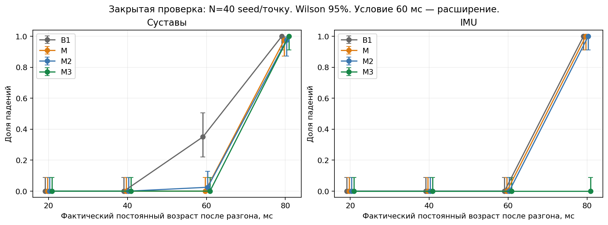

# H1: RL-ходьба при асинхронном устаревании датчиков

**Захар Островский · 9 октября 2026 года**

Готовая LSTM-политика Unitree H1 работает в MuJoCo на CPU.
Сравниваются удержание измерений и компенсация независимых задержек
суставных и инерциальных данных. Политика не переобучается;
для M3 обучается небольшой внешний линейный прогнозатор.
NVIDIA GPU, CUDA и Isaac Gym для запуска не требуются.

**Основной результат:** в шести исходных условиях M3 уменьшил число
падений с 80/240 до 40/240. При задержке IMU 80 мс — 0/40 падений
вместо 40/40 у B1; при задержке суставов 80 мс падения сохранились
и наступали раньше. Результат относится к проверенной политике,
модели и условиям MuJoCo; перенос на аппаратный робот не проверен.

Отчёт включён ниже. Отдельные версии: [Markdown](reports/REPORT.md),
[PDF](reports/REPORT.pdf), [расширенное описание](reports/REPORT_DETAILED.md).
Исходный протокол и подробные результаты M3:
[results/m3_h1/REPORT.md](results/m3_h1/REPORT.md).

## Навигация

- [Постановка, литература и методы](#research)
- [Результаты исследования](#results)
- [Ограничения и следующая гипотеза](#discussion)
- [Получение проекта](#download)
- [Установка](#setup)
- [Интерактивная симуляция](#simulation)
- [Численные эксперименты](#experiments)
- [Графики, таблицы и проверки](#analysis)
- [Структура проекта](#files)
- [Устранение неполадок](#troubleshooting)
- [Научные источники и лицензии](#third_party)

<a id="research"></a>

## 1. Исследование

### 1.1. Постановка задачи

При независимой доставке суставных и инерциальных измерений вход политики объединяет состояния разных моментов времени. Удержание последнего показания не устраняет это рассогласование. Сенсорная задержка отличается от шума текущего измерения и задержки применения действия.

**Цель:** определить, позволяет ли причинный внешний восстановитель уменьшить падения без переобучения готовой RL-политики.

**Гипотеза H₁:** прогноз сенсорных блоков по доставленной истории и индивидуальному возрасту повышает устойчивость фиксированной политики.

**Основной критерий:** снижение средней частоты падений минимум на 10 процентных пунктов и положительная нижняя граница парного 95% интервала в шести заранее заданных условиях: J20/J40/J80/I20/I40/I80. J — суставные данные, I — IMU; число обозначает задержку в миллисекундах. Задержка 60 мс и совместные условия относятся к дополнительным испытаниям.

### 1.2. Анализ литературы

**Humanoid-Gym, 2024 [1].** История наблюдений, PPO и PD-управление обеспечивают перенос на XBot. В статье описана рандомизация задержки; в просмотренном официальном коде она реализована смешиванием текущего и предыдущего действий. Это не эквивалент независимым очередям сенсорных пакетов и не определяет границы исследуемой компенсации.

**Real-world humanoid locomotion with reinforcement learning, 2024 [2].** Причинный Transformer, история наблюдений и действий, RL, имитация и рандомизация обеспечивают ходьбу Digit на разных поверхностях. Основной текст не содержит отдельной оценки независимого устаревания суставов и IMU. Полные диапазоны из supplementary здесь не анализировались.

**RoboDreamer, 2026 [3].** Предиктивная дистилляция и Mamba восстанавливают недавнюю информацию; при обучении маскируются последние кадры. Реальные испытания G1 ограничены условиями без систематически внесённых сенсорных возмущений. В настоящей постановке восстанавливается отдельный блок перед уже обученной политикой.

Анализ основан на полных текстах [1–3]. Внешние компенсаторы перед готовыми политиками известны [4]; сам принцип адаптера не является новым. Исследуемый пробел — влияние раздельной давности проприоцептивных блоков на фиксированную H1-политику. Вклад работы: модель доставки, контролируемое сравнение и установление канальных ограничений. Методы из публикаций не выступают экспериментальными конкурентами.

<a id="methods"></a>

### 1.3. Методы

#### 1.3.1. Контроллер и доставка измерений

Использована готовая LSTM-политика Unitree RL Gym [5]: 41 признак, 10 действий, частота 50 Гц. Физика и локальный PD работают на 500 Гц. Веса, масштабирование входа и физические параметры фиксированы; память LSTM штатно обновляется.

Пакет содержит измерение, время измерения и доставки. На каждом решении выбирается наиболее новый по времени измерения среди доставленных пакетов. Поздний старый пакет не заменяет свежий; при пропуске показание удерживается. Возраст равен текущему времени минус время измерения. Часы синхронизированы. Рабочий адаптер не получает истину MuJoCo; она используется для обучающих целей, оценки и свежей обратной связи PD.

| Метод | Принцип | Горизонт J/I |
|---|---|---|
| B1 | Удержание последнего измерения | Без прогноза |
| M | Постоянная суставная скорость; кинематический поворот гравитации | 20/20 мс |
| M2 | Периодический суставной прогноз; IMU как у M | 120/20 мс |
| M3 | Обученный линейный прогнозатор с регуляризацией | 80/80 мс |

M2 использует до 60 пакетов, период 0,8 с и три гармоники; IMU-компонент совпадает с M. Предыдущая проверка M2 на seed 10–19 не уменьшила падения.

#### 1.3.2. Прогнозатор M3

Признаки: три последних пакета целевого потока, интервалы измерений, последние значения обоих потоков и их возраст, команда, фазовые гармоники и нормированный горизонт. Удержание не создаёт новую историческую точку. Регрессия обучается с ridge = 1; стандартизация рассчитывается только на обучении.

Суставный прогноз привязан к последним измеренным положению и скорости:

```math
\hat q(\tau)=q_s+\dot q_s\tau+A s^2+B s^3,
\qquad
\widehat{\dot q}(\tau)=\dot q_s+\frac{2As+3Bs^2}{T},
\qquad s=\frac{\tau}{T},\quad T=0.08\;\mathrm{s}.
```

τ — возраст, ограниченный 80 мс; коэффициенты A/B предсказываются линейной моделью. Согласованность положения и скорости обеспечивается внутри сегмента при фиксированных коэффициентах; глобальная гладкость между решениями не гарантирована. Поправки и положения ограничиваются. IMU-прогноз добавляет остатки к угловой скорости и кинематически восстановленной гравитации; их совместная динамическая согласованность не навязана. При нулевом возрасте оба блока точно копируются.

Четыре конфигурации различались историей действий и весом поправки 0,5/1,0. Последовательность выбора: меньше падений, больше успехов, больше время, меньше RMSE. Выбран вариант **без истории действий, вес 0,5**, 4/24 падений и 20/24 успехов на подборе. Штатное предыдущее действие во входе политики сохранено. После замораживания модель не меняется онлайн; механизм доверия не используется.

### 1.4. Экспериментальный протокол

Среда: Intel Core i9-12900H, Linux, Python 3.10.12, Torch 2.5.1+cpu, MuJoCo 3.2.7, NumPy 1.26.4; по одному вычислительному потоку. Ровный пол, команда 0,5 м/с вперёд, начальные смещения суставов ±0,003 рад. Эпизод — до 20 с; первые 2 с измерения свежие, далее вводится постоянная задержка.

| Этап | Seed | Эпизоды | Условия |
|---|---|---|---|
| Обучение | 20–25 | 84 | Свежие данные; J/I 40/60/80 мс |
| Подбор | 26–29 | 224 | Отдельные потоки; четыре M3-кандидата и базовые методы |
| Основная проверка | 100–139 | 960 | 6 условий × 4 метода |
| Расширение | 100–139 | 320 | J60/I60 × 4 метода |
| Совместные задержки | 100–109 | 120 | 3 условия × 4 метода |

Seed задаёт начальное случайное возмущение. В парных запусках совпадают начальные состояния и расписания доставки. Обучение использовало 25 919 суставных и 24 364 IMU-строки из 84 эпизодов B1/M2. Закрытые seed не использовались при обучении и выборе; модель, профиль, код и план зафиксированы до открытия проверки. Аудит и журнал подтверждают отсутствие перенастройки.

**Метрики.** Падение: высота таза ниже приблизительно 0,620 м либо крен/тангаж свыше 60° в течение 0,2 с. Время до падения ограничено 20 с. RMSE скорости вычисляется после разгона до завершения эпизода в горизонтальных осях yaw корпуса; агрегат — среднее эпизодных RMSE. Успех: отсутствие падения и RMSE ≤ 0,2 м/с.

**Статистика.** Парный bootstrap по seed, 5000 повторов; все шесть условий выбранного seed сохраняются вместе. Основная серия содержит 40 независимых начальных возмущений. Для отдельных условий — Wilson 95%. Дополнительные интервалы описательные, без поправки на множественные сравнения.

<a id="results"></a>

### 1.5. Результаты

#### 1.5.1. Основная проверка

| Метод | Падения / 240 | Время, с | RMSE, м/с | Успех / 240 |
|---|---|---|---|---|
| B1 | 80 | 15,763 | 0,352 | 160 |
| M | 79 | 16,323 | 0,355 | 160 |
| M2 | 79 | 16,323 | 0,347 | 160 |
| M3 | 40 | 17,782 | 0,268 | 200 |

Частота падений M3 относительно B1 снижена с 33,33% до 16,67%: **16,67 п.п., относительное снижение 50%**. На каждом seed предотвращено одно падение из шести условий; bootstrap-интервал [16,67; 16,67] п.п. вырожден из-за одинакового наблюдаемого эффекта. Основной критерий выполнен для заданного распределения испытаний.

| Условие | Падения B1 → M3 | RMSE B1 → M3 | Время B1 → M3 |
|---|---|---|---|
| J20 | 0 → 0 | 0,1474 → 0,1611 | 20,000 → 20,000 |
| J40 | 0 → 0 | 0,1520 → 0,1787 | 20,000 → 20,000 |
| J80 | 40 → 40 | 0,7639 → 0,8065 | 7,845 → 6,693 |
| I20 | 0 → 0 | 0,1582 → 0,1433 | 20,000 → 20,000 |
| I40 | 0 → 0 | 0,1746 → 0,1454 | 20,000 → 20,000 |
| I80 | 40 → 0 | 0,7160 → 0,1745 | 6,733 → 20,000 |

В таблице приведены **B1 → M3**, N=40 на условие; RMSE в м/с, время в секундах.



Рисунок 1. Доля падений, N=40 на точку, Wilson 95%. 60 мс — дополнительное условие. Соединительные линии не определяют точный порог устойчивости.

**I80:** B1/M/M2 — 40/40 падений, M3 — 0/40 и 40/40 успехов. Верхняя граница Wilson для M3 — 8,76%. **J80:** M3/B1 — 40/40 падений, M/M2 — 39/40; время M3−B1 = −1,152 с, описательный 95% интервал [−2,064; −0,268]. M/M2 живут около 11,36 с, но непавший эпизод не удовлетворяет критерию успеха.

В J20/J40 M3 ухудшает RMSE на 9,33%/17,62%; в I20/I40 улучшает на 9,41%/16,70%. Скорость до падения оценивается на разных по длине участках. Вторичный анализ общего окна B1/M3 даёт разность среднего RMSE −0,0758 м/с, интервал [−0,0995; −0,0512]; физические траектории остаются разными.

#### 1.5.2. Дополнительные условия

| Условие | N | Падения B1 → M3 | RMSE M3, м/с | Успех M3 |
|---|---|---|---|---|
| J60 | 40 | 14 → 0 | 0,212 | 0 |
| I60 | 40 | 0 → 0 | 0,142 | 40 |
| J40I40 | 10 | 0 → 0 | 0,182 | 10 |
| J40I60 | 10 | 9 → 0 | 0,192 | 10 |
| J60I40 | 10 | 10 → 0 | 0,194 | 8 |

В J60 M3 предотвращает падения, но не достигает порога скорости ни в одном эпизоде. M проходит 40/40 успешно, RMSE 0,167 м/с. В I60 падений нет у всех методов, однако только M3 даёт 40/40 успехов; RMSE B1 = 0,237 м/с. Совместные условия проверены на N=10: верхняя граница Wilson для 0/10 — 27,75%. Они не входят в основной критерий.

#### 1.5.3. Диагностика и стоимость

На двух разработочных seed замена устаревшей угловой скорости истинной устранила оба падения I80. На одной общей B1-траектории M3 уменьшал ошибку действий даже в J80, но в собственной траектории падал раньше. В J40 ошибка положения снижалась с 0,0427 до 0,0175 рад при ухудшении скорости. Эти проверки указывают на расхождение точности восстановления и качества замкнутого управления; самостоятельный причинный эффект компонентов не установлен.

Для M3 медиана/p95 адаптера — 0,436/0,659 мс; полного цикла — 1,796/2,682 мс при периоде политики 20 мс. Вычислительная стоимость совместима с CPU-экспериментом; квантили не гарантируют соблюдения аппаратных сроков.

<a id="discussion"></a>

### 1.6. Обсуждение

Выигрыш основной серии обусловлен IMU, а не универсальным улучшением всех каналов. Более точный прогноз отдельных признаков или действий не гарантирует устойчивости рекуррентной системы: ошибка влияет на физическую траекторию и накопленную память политики. Суставный прогноз остаётся барьером.

Границы результата: одна политика H1, ровный пол, постоянная скорость, малые начальные возмущения, постоянные задержки. Перенос на рельеф, другие команды, случайные потери и аппаратный робот не проверен. PD использует свежую обратную связь; шум, дрейф и фильтры реальной IMU не моделируются. Фаза задана периодом 0,8 с; перенос на другой темп не установлен. Полная абляция компонентов отсутствует.

**Следующая гипотеза:** раздельный выбор IMU- и суставного восстановителей по падениям и качеству движения превосходит единый профиль. Кандидат — IMU-компонент M3 и суставной компонент M/M2 либо новая согласованная модель. Комбинация не испытана; эффекты отдельных потоков неаддитивны.

Проверка требует новых разработочных данных, сравнения канальных комбинаций при одинаковых горизонтах, совместных задержек и нескольких команд. Один вариант фиксируется до новой закрытой серии. Seed 100–139 после просмотра не используются как независимая проверка дальнейшей настройки.

### 1.7. Заключение

Причинный линейный восстановитель M3 повысил устойчивость фиксированной H1-политики при задержке IMU 80 мс без повторного RL-обучения. Основной критерий выполнен: 80/240 → 40/240 падений. При суставных задержках выявлены ухудшение скорости и более ранние падения. Открытая задача — согласовать выбор канального прогноза с устойчивостью и качеством замкнутого движения.

---

<a id="download"></a>

## 2. Получение проекта

Если каталог проекта уже есть на компьютере, перейдите в него:

```bash
cd /путь/к/rl_locomotion_sensor_age
```

Для получения через Git замените `URL_РЕПОЗИТОРИЯ` адресом этого проекта:

```bash
git clone URL_РЕПОЗИТОРИЯ rl_locomotion_sensor_age
cd rl_locomotion_sensor_age
```

В команде указан шаблон адреса. Если проект предоставлен архивом, распакуйте его
и откройте в терминале каталог, где лежат `README.md`, `requirements.txt`
и папка `scripts/`.

Все дальнейшие команды выполняются из этого каталога. Копировать `.venv`
с другого компьютера не нужно: установщик создаёт окружение заново.
Веса и модель H1 загружаются автоматически на следующем шаге.

<a id="setup"></a>

## 3. Установка

Проверенная платформа: Linux x86_64, Python 3.10.12. Нужны Интернет для
первой установки и несколько ГБ свободного диска. Окно симуляции требует
графического рабочего стола; численные эксперименты работают без окна.

На Ubuntu 22.04 системные предпосылки устанавливаются один раз:

```bash
sudo apt-get update
sudo apt-get install -y python3.10 python3.10-venv git libgl1 libegl1 libglfw3 libgl1-mesa-dri
```

Это отдельная команда пользователя: проектный установщик не запускает
`sudo` и не меняет глобальные Python-пакеты. На других дистрибутивах нужны
эквивалентные пакеты и Python 3.10; Python 3.12 этим lock-файлом не проверен.

В терминале перейдите в каталог проекта и выполните:

```bash
./scripts/setup.sh
```

После успешной установки сразу откройте симуляцию:

```bash
./scripts/launch_h1_sandbox.sh
```

Если после распаковки утрачены права запуска, восстановите их:

```bash
chmod +x scripts/setup.sh scripts/launch_h1_sandbox.sh scripts/launch_interactive_h1.sh
```

Скрипт создаёт `.venv`, устанавливает точные версии из
[requirements.txt](requirements.txt), включая `torch==2.5.1+cpu`,
получает официальный Unitree RL Gym на commit
`276801e46c5d433564f24658bac64f254b7d2d4b`, проверяет зависимости,
SHA-256 весов/XML/мешей/конфигурации и запускает baseline на 5 секунд.
Установлены также инструменты графиков и записи видео.
Лог команд и результат проверки сохраняются в `results/setup/`.

Результат установки:

| Путь | Что установлено или сохранено |
|---|---|
| `.venv/` | Python-зависимости проекта |
| `vendor/unitree_rl_gym/` | Закреплённая версия официального upstream |
| `vendor/unitree_rl_gym/deploy/pre_train/h1/motion.pt` | Готовая TorchScript-политика H1 |
| `vendor/unitree_rl_gym/resources/robots/h1/` | XML, меши и модель робота |
| `results/setup/setup_*.log` | Команды и результаты установки |
| `results/setup/smoke_*/` | Пятисекундная проверка штатной ходьбы |

Отдельно скачивать веса, устанавливать тренировочный стек или обучать
политику для первого запуска не требуется.

Активация окружения не обязательна: команды используют `.venv/bin/python`.
Можно указать другой путь к Python 3.10:

```bash
PYTHON=/path/to/python3.10 ./scripts/setup.sh
```

Существующие `.venv` и upstream проверяются; несовпадающий checkout
автоматически не сбрасывается. Для повторной проверки без загрузок:

```bash
./scripts/setup.sh --offline
```

Проверен путь `--offline` на подготовленном окружении.
Полная установка в пустое окружение и загрузка через новую сеть пока
не проверены отдельно.

<a id="simulation"></a>

## 4. Интерактивная симуляция

```bash
./scripts/launch_h1_sandbox.sh
```

Симуляция работает до выхода. Камера следует за роботом, перетаскивание
левой кнопкой мыши вращает её вокруг робота на фиксированном расстоянии.
Начальный режим — ходьба без компенсации.

| Клавиша | Действие |
|---|---|
| `W` | Переключить команду идти вперёд / стоять |
| `C` | Переключить B1 / M2 |
| `R` | Поднять робота, очистить память и историю, включить команду стоять |
| Удерживать `I` | Блокировать новые IMU-пакеты |
| Удерживать `J` | Блокировать новые суставные пакеты |
| `Esc` | Закончить запуск |

Нулевая команда политики допускает подшагивание и дрейф; фиксация робота
в одной точке не реализована. Длительные отключения могут вызвать падение.
Для старого кинематического M:

```bash
./scripts/launch_h1_sandbox.sh --compensator legacy
```

Отдельная ограниченная демонстрация 20 секунд:

```bash
./scripts/launch_interactive_h1.sh
./scripts/launch_interactive_h1.sh --method M
```

[Подробности управления, событий, камеры и логов](docs/README.md#interactive_demo).
Безлимитный режим пишет журнал частями, не храня всю историю в RAM.

По умолчанию оба интерактивных режима создают новый каталог
`results/interactive_h1/ДАТА_ВРЕМЯ/`; точный путь выводится в терминале
после завершения. Можно явно выбрать новый каталог:

```bash
./scripts/launch_h1_sandbox.sh --output results/user_runs/my_demo
```

Свободный режим сохраняет `summary.json`, события в `events.jsonl`
и временные ряды в `chunks/`. Ограниченный режим сохраняет
`trajectory.csv`, `signals.npz` и `key_events.json`.

<a id="experiments"></a>

## 5. Численные эксперименты

Запускайте из корня; используйте новые каталоги вывода.
Численные эпизоды ограничены симуляционным временем и не содержат
ожиданий для синхронизации с реальными часами.

Сначала штатная ходьба, 20 секунд:

```bash
OMP_NUM_THREADS=1 OPENBLAS_NUM_THREADS=1 MKL_NUM_THREADS=1 \
  .venv/bin/python -I scripts/run_h1_baseline.py \
  --seconds 20 --threads 1 --output results/user_runs/baseline20
```

Парное сравнение алгоритмов на сохранённом сценарии J40, seed 10:

```bash
for method in B1 M; do
  OMP_NUM_THREADS=1 OPENBLAS_NUM_THREADS=1 MKL_NUM_THREADS=1 \
    .venv/bin/python -I scripts/run_sensor_episode.py \
    --initial results/m2_validation_h1/inputs/seed_10/initial.json \
    --schedule results/m2_validation_h1/inputs/seed_10/J40.json \
    --method "$method" --horizon-joints-ms 20 --horizon-imu-ms 20 \
    --output "results/user_runs/J40_$method"
done
OMP_NUM_THREADS=1 OPENBLAS_NUM_THREADS=1 MKL_NUM_THREADS=1 \
  .venv/bin/python -I scripts/run_sensor_episode.py \
  --initial results/m2_validation_h1/inputs/seed_10/initial.json \
  --schedule results/m2_validation_h1/inputs/seed_10/J40.json \
  --method M2 --output results/user_runs/J40_M2
```

M2 автоматически загружает [configs/m2_profile.json](configs/m2_profile.json)
с горизонтом 120/20 мс. M без явных горизонтов использует исторический
default 40/40 мс; для сравнения с отчётом нужны 20/20 мс.
`summary.json` содержит условия и метрики, `trajectory.csv` — временные
ряды, `signals.npz` — входы, действия и физические показания.

В приведённом примере `J40` означает задержку суставов 40 мс при свежем
IMU. В том же каталоге входов доступны `J20`, `J80`, `I20`, `I40`, `I80`;
для другого сохранённого условия замените имя файла `--schedule` и каталог
`--output`. `I40` означает задержку IMU 40 мс при свежих суставах.

[Описание методов и горизонтов](#methods) приведено в исследовательской части.

### Зафиксированный M3

Численная проверка M3 и сравнения B1/M/M2 хранятся отдельно в
[results/m3_h1/REPORT.md](results/m3_h1/REPORT.md). Готовая ridge-модель
лежит в [results/m3_h1/frozen/model.npz](results/m3_h1/frozen/model.npz);
новые зависимости и обучение RL-политики для её запуска не нужны.

Повтор одного эпизода с задержкой IMU 80 мс:

```bash
OMP_NUM_THREADS=1 OPENBLAS_NUM_THREADS=1 MKL_NUM_THREADS=1 \
  .venv/bin/python -I scripts/run_sensor_episode.py \
  --initial results/m3_h1/inputs/seed_100/initial.json \
  --schedule results/m3_h1/inputs/seed_100/I80.json \
  --method M3 --output results/user_runs/M3_seed100_I80
```

M3 автоматически читает [configs/m3_profile.json](configs/m3_profile.json):
горизонты 80/80 мс, вес поправки 0,5, выбранный вариант без истории действий.
Доступны отдельные `J20/J40/J60/J80`, `I20/I40/I60/I80` и совместные
`J40I40/J60I40/J40I60` (для совместных проверок seed 100–109).
Заменяйте файл расписания и задавайте новый каталог вывода.
`J` — суставы, `I` — IMU; числа — задержка в миллисекундах.
На решениях политики 50 Гц номинальные 50/60 мс эквивалентны, как и 70/80 мс.

Канонический профиль, модель, хеши кода и план проверки —
[results/m3_h1/frozen/](results/m3_h1/frozen/).
Параметры зафиксированы до открытия seed 100–139.
Поле `test_opened: false` в профиле сохраняет этот исторический статус;
фактическое открытие серии записано в `frozen/opened.json`.
Графики PNG/PDF — [figures/](results/m3_h1/figures/),
CSV — [tables/](results/m3_h1/tables/), команды и логи — в каталоге серии.
Повтор анализа сохранённых результатов:

```bash
.venv/bin/python -I scripts/analyze_m3.py
```

Интерактивная клавиша `C` по-прежнему переключает B1/M2;
M3 в этом этапе проверяется численными эпизодами.

Не перезаписывайте каталоги сохранённых исследовательских серий.
При повторном запуске примеров выбирайте новое имя в `results/user_runs/`.

Для видео к одному эпизоду добавьте `--video` и переменные
`MUJOCO_GL=egl LIBGL_ALWAYS_SOFTWARE=1`; нужен рабочий Mesa/EGL.

Новая пилотная серия в отдельном каталоге, без закрытых seed:

```bash
for stage in prepare validate primary extensions; do
  OMP_NUM_THREADS=1 OPENBLAS_NUM_THREADS=1 MKL_NUM_THREADS=1 \
    .venv/bin/python -I scripts/run_pilot.py \
    --stage "$stage" --output results/user_runs/new_pilot
done
.venv/bin/python -I scripts/summarize_pilot.py --output results/user_runs/new_pilot
.venv/bin/python -I scripts/plot_pilot.py --output results/user_runs/new_pilot
```

Серия объёмнее одного эпизода; условия — [configs/pilot.yaml](configs/pilot.yaml).
Для новых гипотез сначала выделите данные разработки: уже просмотренные
seed 0–29 и открытые seed 100–139 не должны снова называться закрытой
проверкой нового подбора. Для следующего алгоритма нужны новые seed.

<a id="analysis"></a>

## 6. Анализ и проверка данных

Перестроить сводные материалы из сохранённых результатов:

```bash
.venv/bin/python -I scripts/build_report_assets.py
```

Скрипт обновляет графики и таблицы этапов M/M2 в `reports/`, а также
manifest с SHA-256 источников. Он не запускает эксперименты.
Для результатов M3 используется `scripts/analyze_m3.py`, приведённый выше.

| Что посмотреть | Где открыть |
|---|---|
| Итоговый исследовательский отчёт | [Markdown](reports/REPORT.md), [PDF](reports/REPORT.pdf) |
| Расширенное описание методов и статистики | [reports/REPORT_DETAILED.md](reports/REPORT_DETAILED.md) |
| Проверка 1400 закрытых эпизодов и 56 групп | [report_data_verification.json](reports/report_data_verification.json) |
| M3: исходный протокол, закрытая проверка и аудит | [results/m3_h1/REPORT.md](results/m3_h1/REPORT.md) |
| M3: падения и парные разности | [falls.png](results/m3_h1/figures/falls.png), [paired_differences.png](results/m3_h1/figures/paired_differences.png) |
| M3: CSV всех эпизодов и статистики | [results/m3_h1/tables/](results/m3_h1/tables/) |
| M/M2: падения в зависимости от задержки | [fall_rate.png](reports/figures/fall_rate.png) |
| M/M2: ошибка скорости | [velocity_rmse.png](reports/figures/velocity_rmse.png) |
| M/M2: время до падения | [mean_alive_s.png](reports/figures/mean_alive_s.png) |
| M/M2: равные задержки, потери и jitter | [fault_modes.png](reports/figures/fault_modes.png) |
| M/M2: проверенные кандидаты | [candidates.png](reports/figures/candidates.png) |
| M/M2: вычислительное время | [cpu_timing.png](reports/figures/cpu_timing.png) |
| Все численные таблицы | [reports/tables/README.md](reports/tables/README.md) |
| Данные для внешнего анализа | CSV-файлы в `reports/tables/` |

Рядом с PNG находится PDF с тем же именем. Графики этапов M/M2
разделяют подбор seed 0–9 и проверку 10–19; графики M3 относятся
к закрытой серии 100–139. RMSE аварийных эпизодов усечён до падения.

Проверка сохранённых сводок без симуляции и обучения:

```bash
.venv/bin/python -I scripts/verify_completed_report.py
```

Скрипт сверяет индивидуальные summary.json и их хеши, пересчитывает
56 групп и основной парный эффект; результат сохраняется в
`reports/report_data_verification.json`.

Основные проверки пакетов и компенсаторов:

```bash
for check in sensor_age history_compensator periodic_compensator cycle_compensator conservative_compensator hybrid_compensator m3; do
  .venv/bin/python -I "scripts/check_$check.py"
done
```

Проверяются нулевой возраст, причинность, перестановка доставки, рост возраста
при потерях, линейное движение, знак вращения гравитации и предел прогноза.

<a id="files"></a>

## 7. Структура проекта

```text
README.md             исследование, результаты, установка и команды
requirements.txt      точные Python-зависимости, CPU PyTorch
reports/              общий отчёт, перспективы, сводные графики и таблицы
docs/                 теория, протокол и описание реализации
configs/              параметры пилота и профили M2/M3
scripts/              запуск, адаптеры, проверки и анализ
results/              исходные серии, команды, логи и снимки кода
vendor/               локальный upstream, игнорируется Git
.venv/                проектное окружение, игнорируется Git
```

| Задача | Файл или каталог |
|---|---|
| Установка | [scripts/setup.sh](scripts/setup.sh), [requirements.txt](requirements.txt) |
| Проверка окружения и ассетов | [scripts/verify_setup.py](scripts/verify_setup.py) |
| Окно и управление роботом | [scripts/interactive_h1.py](scripts/interactive_h1.py) |
| Штатная ходьба | [scripts/run_h1_baseline.py](scripts/run_h1_baseline.py) |
| Один численный эпизод | [scripts/run_sensor_episode.py](scripts/run_sensor_episode.py) |
| Очереди пакетов и исходный M | [scripts/sensor_age.py](scripts/sensor_age.py) |
| Выбранный M2 | [scripts/hybrid_compensator.py](scripts/hybrid_compensator.py), [scripts/periodic_compensator.py](scripts/periodic_compensator.py) |
| Настройки выбранного M2 | [configs/m2_profile.json](configs/m2_profile.json) |
| M3: адаптер, обучение и проверки | [scripts/linear_compensator.py](scripts/linear_compensator.py), [scripts/train_m3.py](scripts/train_m3.py), [scripts/check_m3.py](scripts/check_m3.py) |
| Зафиксированный профиль M3 | [configs/m3_profile.json](configs/m3_profile.json) |
| Проверка чисел итогового отчёта | [scripts/verify_completed_report.py](scripts/verify_completed_report.py) |
| M3: результаты, модель и хеши | [results/m3_h1/REPORT.md](results/m3_h1/REPORT.md), [results/m3_h1/frozen/](results/m3_h1/frozen/) |
| Настройки пилота | [configs/pilot.yaml](configs/pilot.yaml) |
| Baseline: отчёт и измерения | [results/baseline_h1/REPORT.md](results/baseline_h1/REPORT.md) |
| Пилот: отчёт, команды и таблицы | [results/pilot_h1/REPORT.md](results/pilot_h1/REPORT.md) |
| Проверка M2: отчёт и измерения | [results/m2_validation_h1/REPORT.md](results/m2_validation_h1/REPORT.md) |
| Команды разработки M2 | [results/m2_h1_setup/commands.md](results/m2_h1_setup/commands.md) |
| Все исходные серии и их назначение | [results/README.md](results/README.md) |
| Новые пользовательские запуски | `results/user_runs/` |
| Теория, протокол и реализация | [docs/README.md](docs/README.md) |
| Библиография | [references.bib](references.bib) |

[Карта кода](scripts/README.md), [карта результатов](results/README.md),
[теория](docs/README.md#research), [протокол](docs/README.md#experiment_protocol),
[реализация пакетов](docs/README.md#sensor_age_implementation),
[разработка M2](docs/README.md#m2_development), [лицензии](README.md#third_party).

Старые команды и снимки исходников сохранены вместе с измерениями.
Отрицательные результаты и неудачные кандидаты не удалены при очистке.
`configs/protocol.yaml` и `configs/test_candidate.yaml` относятся к исходному
плану и прежнему кандидату. Завершённую проверку M3 описывают профиль
и план в `results/m3_h1/frozen/`.

<a id="troubleshooting"></a>

## 8. Устранение неполадок

- Нет `python3.10` или `venv`: установите системные предпосылки выше.
- `Permission denied` при запуске `.sh`: выполните команду `chmod +x`
  из раздела установки.
- Ошибка сети: повторите `setup.sh` после восстановления доступа к PyPI,
  download.pytorch.org и GitHub; лог находится в `results/setup/`.
- Ошибка хеша весов: проверьте commit и наличие настоящего checkpoint,
  а не Git LFS-указателя. Установщик откажется запускать подменённые ассеты.
- Ошибка GLFW/display: запускайте окно из графического сеанса Linux.
  Headless baseline не требует display. Software-rendering включён в launcher.
- Ошибка EGL при видео: проверьте системный Mesa/EGL. Численные
  эксперименты без `--video` могут выполняться независимо от рендера.

Сбои моделируются **только на входе политики**, PD получает свежие показания.
Результаты относятся к проверенной H1-политике и модели сбоев в симуляции;
перенос на реального робота не проверен.


---

<a id="third_party"></a>

## 9. Внешние материалы и лицензии

В комплект входят аналитические тексты, спецификация исследования и минимальный runner, адаптированный из официального примера Unitree. Полные статьи, upstream и веса не публиковались; локально загруженный upstream находится в игнорируемом `vendor/`.

### Unitree RL Gym

Источник: https://github.com/unitreerobotics/unitree_rl_gym

Использован для CPU MuJoCo inference H1. Проверенный и запущенный commit: `276801e46c5d433564f24658bac64f254b7d2d4b`. LICENSE этого commit — BSD 3-Clause, Copyright (c) 2016–2023 HangZhou YuShu TECHNOLOGY CO., LTD. (Unitree Robotics). Полный текст с условиями и disclaimer сохранён в [results/baseline_h1/UNITREE_LICENSE](results/baseline_h1/UNITREE_LICENSE).

[scripts/run_h1_baseline.py](scripts/run_h1_baseline.py) использует соглашения и формулы `deploy/deploy_mujoco/deploy_mujoco.py`. Локальные checkpoint `deploy/pre_train/h1/motion.pt`, XML и меши получены из того же официального git checkout; отдельная загрузка сторонних моделей не выполнялась. Происхождение и SHA-256 — в [отчёте](results/baseline_h1/REPORT.md). Отдельной лицензии checkpoint в проверенном пути не обнаружено; лицензия репозитория не трактуется как доказательство прав на произвольные внешние модели. Публикация ассетов не выполнялась.

[scripts/run_sensor_episode.py](scripts/run_sensor_episode.py) сохраняет те же формулы контроллера и соглашения; атрибуция BSD указана в его заголовке и сохранена в `UNITREE_LICENSE`. Транспорт пакетов, компенсатор и пилотный анализ реализованы в проекте отдельно от upstream.

### Humanoid-Gym

Источник: https://github.com/roboterax/humanoid-gym

Прочитанный commit: ae46e201c85a2b17e7f2cea59a441dae7ea88a8f. Код использован для анализа механизма action_delay; не включён в комплект.

### Научные источники

1. Gu X., Wang Y.-J., Chen J. **Humanoid-Gym: Reinforcement Learning for Humanoid Robot with Zero-Shot Sim2Real Transfer.** 2024, arXiv:2404.05695v2. [Полный текст](https://arxiv.org/html/2404.05695v2), [официальный код](https://github.com/roboterax/humanoid-gym), просмотренная версия `ae46e201c85a2b17e7f2cea59a441dae7ea88a8f`.
2. Radosavovic I. и соавт. **Real-world humanoid locomotion with reinforcement learning.** Science Robotics 9(89), eadi9579, 2024. [Авторский PDF](https://hybrid-robotics.berkeley.edu/publications/ScienceRobotics2024_Learning_Humanoid_Locomotion.pdf). Использован основной текст.
3. Li Z. и соавт. **RoboDreamer: Anticipatory Humanoid Locomotion with Predictive State-Space Models.** 2026, arXiv:2609.07096v2, препринт. [Полный текст](https://arxiv.org/html/2609.07096v2).
4. Mednikov M., Gal O. **Decoupled Delay Compensation: Enhancing Pre-trained MARL Policies via Learned Dynamics Filtering.** 2026, arXiv:2605.26286. [Аннотация](https://arxiv.org/abs/2605.26286); количественные результаты не используются.
5. Unitree Robotics. **Unitree RL Gym.** [Официальный код](https://github.com/unitreerobotics/unitree_rl_gym), использованный commit `276801e46c5d433564f24658bac64f254b7d2d4b`.

### Библиография и границы воспроизведения

Ссылки и библиографические записи — в [теоретической части](docs/README.md#research)
и [references.bib](references.bib). Собственное экспериментальное исследование
с политикой Unitree не является полным воспроизведением работ на XBot, Digit
или RoboDreamer.
