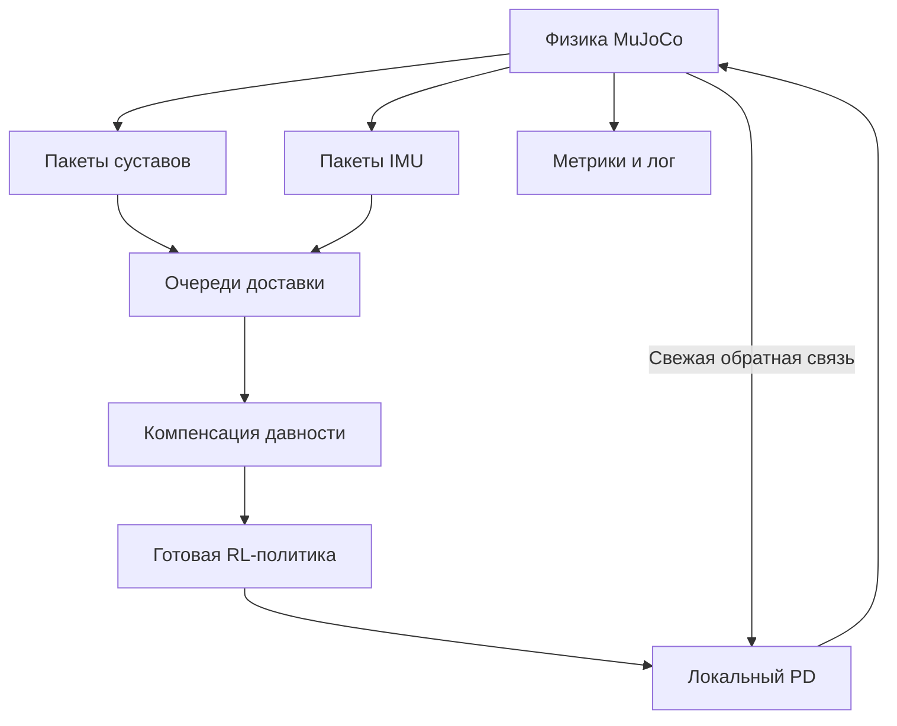

# Документация

Для запуска — [корневой README](../README.md), для выводов и перспектив —
[общий отчёт](../reports/REPORT.md). Здесь подробности исследовательской работы.

| Документ | Назначение |
|---|---|
| [Теория](README.md#research) | Исходная теория и анализ литературы; исторический статус 7 октября |
| [Протокол](README.md#experiment_protocol) | Методы, метрики, парность и ограничения проверки |
| [Пакеты и компенсация](README.md#sensor_age_implementation) | Пакеты, очереди и исходный компенсатор |
| [Разработка M2](README.md#m2_development) | Формулы M2, кандидаты и изменения протокола |
| [Разработка M3](README.md#m3_development) | Причинный ridge-прогноз, разделение данных и зафиксированная проверка |
| [Интерактивная демонстрация](README.md#interactive_demo) | Клавиши, камера, события и запись |
| [Практические этапы](README.md#practical_steps) | Историческая последовательность практических стадий |
| [Источники](README.md#evidence), [source_manifest.json](source_manifest.json) | Проверенные источники и происхождение |
| [Вопросы для обсуждения](README.md#interview_notes) | Подготовка к обсуждению исследования |

Исходные плановые числа и формулировки не переписаны задним числом как
результаты. Актуальные измерения находятся в отчётах и results/.

<a id="m3_development"></a>

## Уточнение протокола для M3

План M3 записан до новых серий в `results/m3_h1/plan.json` и сохранён
дословно в [отчёте M3](../results/m3_h1/REPORT.md#preregistered).
Seed 0–19 уже просмотрены; 20–25 выделены под диагностику и ridge-fit,
26–29 — под подбор четырёх кандидатов по исходным шести E2.
Разделение проходит по эпизодам, не по соседним строкам траектории.

Интерфейс расширен доставленной историей, известной командой, фазой
и необязательными четырьмя ранее выданными действиями.
Отдельно сравниваются модели с действиями и без них; свежие блоки
копируются точно, нормализация политики применяется после прогноза.
Истина MuJoCo используется как цель регрессии, метрика и явно обозначенный
oracle; рабочий адаптер получает только доставленные пакеты и контекст.

Суставные q/dq вычисляются из одной кубической кривой и её производной
при фиксированных признаках. Это не обещает глобально гладкого прогноза
между переоценками. Положения ограничены XML; g нормализуется;
горизонт обоих потоков ограничен 80 мс. При возрасте больше горизонта
возвращается прогноз на его конце, а не оценка текущего состояния с
неограниченной экстраполяцией. Совместная динамика omega/g не навязывается.

Закрытая проверка зафиксированного M3: seed 100–139, B1/M/M2/M3,
исходные J20/J40/J80/I20/I40/I80. Критерий прежний: снижение падений
минимум на 10 п.п. и положительная нижняя граница парного 95% интервала.
Bootstrap выбирает seed целиком, включая все шесть условий.
J60/I60 и ограниченные совместные J40I40/J60I40/J40I60 анализируются отдельно.
Номинальные 50/60 и 70/80 мс дают одинаковые выбранные измерения на сетке
политики 50 Гц; это не независимые условия.

Перед открытием серии сохранены модель, профиль, исходники, SHA-256 и
план в `results/m3_h1/frozen/`. После открытия перенастройка запрещена;
теперь эти seed нельзя использовать как закрытые для нового алгоритма.
Итоговые результаты, ограничения, реальные команды и первичные массивы
находятся в отдельном каталоге M3. Исторические протоколы ниже сохранены
со статусом на момент соответствующих этапов.


---

<a id="evidence"></a>

# Карта доказательств и границы доступа

Дата проверки: 7 октября 2026. `Факт` означает непосредственно прочитанное утверждение или настройку. `Интерпретация` и `предложение` обозначают выводы этой работы. Экспериментальных результатов проекта нет.

| Сведение | Статус | Где проверено | Граница вывода |
|---|---|---|---|
| Humanoid-Gym: 15 кадров, 47 признаков, 100/1000 Гц | Факт статьи | [Текст](https://arxiv.org/html/2404.05695v2), III-B, таблицы I–II | Не описание всех политик Unitree |
| Humanoid-Gym: System Delay 0–10 мс | Факт статьи | Там же, таблица III | Таблица не устанавливает отдельную очередь каждого датчика |
| В просмотренном `step()` новая команда смешивается с предыдущей | Факт кода | [humanoid_env.py](https://github.com/roboterax/humanoid-gym/blob/ae46e201c85a2b17e7f2cea59a441dae7ea88a8f/humanoid/envs/custom/humanoid_env.py), функция step | Интерполяцию действий нельзя отождествлять с задержкой наблюдения |
| Digit: Transformer и history/action pairs; шум и задержки наблюдения | Факт статьи | [PDF](https://hybrid-robotics.berkeley.edu/publications/ScienceRobotics2024_Learning_Humanoid_Locomotion.pdf), Materials and Methods | Полный набор дополнительных материалов не прочитан |
| RoboDreamer: masking последних 1–5 кадров | Факт статьи | [Текст v2](https://arxiv.org/html/2609.07096v2), 3.4 | Это близкая существующая техника, а не новая идея этой работы |
| Реальная оценка RoboDreamer ограничена G1 без систематически вводимых sensing disturbances | Факт статьи | Там же, раздел 5 | Не означает отсутствия любой проверки робастности в симуляции |
| Kim и соавт.: сравнение history/noise/bias/delay | Факт доступной аннотации | [Описание IEEE](https://ramagazine.ieee.org/2025/03/18/bridging-the-reality-gap-analyzing-sim-to-real-transfer-techniques-for-reinforcement-learning-in-humanoid-bipedal-locomotion/) | Полный текст недоступен; деталей опытов не приписываем |
| RPL моделирует сбои глубины | Факт статьи | [Текст](https://arxiv.org/html/2602.03002), описание метода | Смежная задача внешнего восприятия |
| Пример H1: 41 признаков, 10 действий, 50 Гц | Факт кода/конфигурации | [h1.yaml](https://github.com/unitreerobotics/unitree_rl_gym/blob/276801e46c5d433564f24658bac64f254b7d2d4b/deploy/deploy_mujoco/configs/h1.yaml), [deploy_mujoco.py](https://github.com/unitreerobotics/unitree_rl_gym/blob/276801e46c5d433564f24658bac64f254b7d2d4b/deploy/deploy_mujoco/deploy_mujoco.py) | Реальные байты весов и запуск пока не проверены |
| Асинхронный вход может соединять состояния разных моментов | Вывод постановки | Определения sample_time/delivery_time/age в research.md | Значимость для выбранной политики проверит эксперимент |
| Внешний компенсатор уменьшит падения | Гипотеза | Раздел 5 research.md | Не измеренный результат |
| 20 с, 40 тестовых seed, критерий 10 п.п. | Предложенные настройки | experiment_protocol.md | Не цифры из статей |

## Версии прочитанного кода

Четыре файла скачаны для чтения и сопоставлены с файлами по конкретным commit. Совпадение байтов проверено; SHA-256 сохранены в source_manifest.json. Ни один скачанный модуль не исполнялся.

Контрольные суммы исходников не заменяют хеши будущих checkpoint/XML. При практическом запуске они будут добавлены в отдельный run manifest.

## Поиск близких работ

Проверялись запросы по сочетаниям humanoid/legged locomotion, observation delay, sensor dropout, asynchronous sensing, timestamps и sim-to-real. Получены как релевантные, так и нерелевантные результаты. Были использованы первичные тексты; агрегаторы не служат основанием технических утверждений.

Поиск не является систематическим обзором всех работ по сетевому управлению и оценке состояния. Поэтому отсутствие найденного точного совпадения не превращается в доказательство глобальной новизны. Предлагаемый вклад ограничен конкретной моделью сбоев, фиксированной политикой и будущей проверкой.

## Непроверенные практические вопросы

- Совместимость конкретного H1 TorchScript checkpoint с целевым CPU PyTorch.
- Устойчивая ходьба исходного примера на Linux пользователя.
- Реальная производительность и возможность работы в реальном времени.
- Реалистичность выбранных диапазонов задержек для аппаратной сети.
- Доступность пригодного CPU checkpoint RoboDreamer.
- Все подробности IEEE-статьи Kim и соавт.

Эти пункты обозначены явно, чтобы будущие выводы не основывались на предположениях.


---

<a id="experiment_protocol"></a>

# Протокол будущего эксперимента

Обновление 9 октября: [разработка M2](README.md#m2_development) выполнена после
отрицательного пилота; профиль выбран на seed 0–9 и проверен без подстройки
на дополнительных seed 10–19. [Отчёт](../results/m2_validation_h1/REPORT.md).
Закрытая серия seed 100–139 ниже остаётся невыполненной. Старый M и его
кандидат configs/test_candidate.yaml сохранены; M2 фиксируется отдельно в
configs/m2_profile.json. Не смешивать эту дополнительную проверку с
первоначально предложенной закрытой серией и не заявлять снижение падений.

Статус: предварительно зафиксированный план закрытой проверки. На 8 октября 2026 реализованы baseline, пакеты и компенсация; выполнен [пилот seed 0–9](../results/pilot_h1/REPORT.md). Закрытая тестовая серия не выполнена. Уточнения реализации и критерия высоты до теста описаны в [Пакеты и компенсация](README.md#sensor_age_implementation), параметры-кандидаты — в `configs/test_candidate.yaml`. Ниже сохранён исходный протокол; пилот не заменяет независимую проверку гипотезы.

## 1. Объект и неизменяемые параметры

- Кандидат: официальный пример Unitree H1 из Unitree RL Gym.
- Веса, XML-сцена, порядок признаков, нормализация, PD-коэффициенты и масштаб действий одинаковы для всех методов.
- Один экземпляр MuJoCo на CPU; без обучения и GPU-симуляторов.
- Физический шаг кандидата: 2 мс; период политики: 20 мс.
- Основная команда: $v_x=0.5$ м/с, $v_y=0$, $\omega_z=0$ на ровной поверхности.
- Эпизод: 20 с симуляционного времени, первые 2 с — штатная работа без сбоев. Если выбранная политика не проходит этот участок, её сначала исправляют или меняют до сравнения методов.
- Фиксируются Python, зависимости, CPU, число потоков, upstream commit, SHA-256 весов, конфигурации и записи начальных состояний.

Предложенная длительность и диапазоны являются настройками исследования, а не характеристиками реального сетевого канала. CPU-бюджет определяют после измерения времени первого запуска.

## 2. Модель сенсорных пакетов

Сенсорный пакет содержит `stream`, `sample_time`, `delivery_time`, `payload`. Время измерения и время поступления различаются. В первичной модели оба потока формируют пакеты при каждом обновлении политики. IMU-пакет включает согласованные по времени $g_B$ и $\omega_B$; суставный пакет — $q$ и $\dot q$.

Очереди независимы. На каждом шаге сначала доставляются уже доступные пакеты, затем выбирается пакет с наибольшим `sample_time`. Более старый пакет, пришедший после нового, не перезаписывает показания. Потеря означает отсутствие доставки, а не замену значения нулём. При отсутствии нового пакета удерживается последнее доступное измерение.

До нормализации адаптер получает только доставленные измерения и метки. Текущее истинное состояние, будущие пакеты и будущие действия ему недоступны. Все истинные состояния остаются на стороне физики и расчёта метрик.

Расписания потерь/доставки создаются заранее и сохраняются. В парных сравнениях используются одинаковые начальное состояние и расписание. Само движение в разных методах может различаться, поэтому совпадает схема доставки, а не измеренные значения.

Сбои вносятся только во вход политики. Локальный PD использует свежие реальные для симулятора $q,\dot q$. Задержка действий в основной серии равна нулю.

## 3. Методы сравнения

| Код | Метод | Назначение |
|---|---|---|
| B0 | Штатная политика со свежими данными | Проверка работоспособности; чистый ориентир |
| B1 | Последний доставленный пакет, без предсказания | Главный baseline при сбое |
| B2 | Та же кинематическая модель, но общий возраст $\max(\delta_J,\delta_I)$ | Проверка необходимости индивидуального возраста |
| M | Предсказание с $\delta_J$ и $\delta_I$ отдельно | Предложенный метод |
| AJ | Только суставная компенсация | Абляция вклада суставов |
| AI | Только IMU-компенсация | Абляция вклада IMU |

B2 является диагностической упрощённой реализацией, а не сильным современным методом из литературы. Выигрыш над ним не заменяет сравнение с B1. B0 проходит отдельные чистые серии; доступ к истинному состоянию при сбое не включается в основной baseline.

## 4. Настройка и закрытая проверка

Набор настройки: seed 0–9. Набор проверки: seed 100–139. Seed управляет сохранённым начальным состоянием и расписанием сбоев. Небольшие возмущения начальных суставных положений допускаются только после проверки корректной конфигурации; предложенная граница — ±0,003 рад. Все параметры выбираются до тестовой серии.

Кандидаты горизонтов: $H_J,H_I\in\{20,40,80\}$ мс. Настройка сначала минимизирует долю падений, при равенстве максимизирует ограниченную длительность без падения, затем минимизирует ошибку скорости. Параметры нельзя подбирать отдельно под каждую тестовую точку. Если увеличение серии на CPU слишком дорого, используется общий горизонт из тех же трёх значений; это фиксируется до проверки.

В основном протоколе отсутствует дополнительный шум. Отдельная проверка с шумом выполняется после основных серий: шум должен добавляться при формировании измерения, а не при каждом повторном использовании старого пакета.

## 5. Условия сбоев

### E0. Чистый контроль

Свежие измерения, отсутствие потерь. Проверяются B0, B1 и M. При $\delta_J=\delta_I=0$ M должен воспроизводить исходный вход и действие с численной точностью.

### E1. Одинаковое постоянное отставание

$d_J=d_I\in\{20,40,80,120\}$ мс. Это проверяет общий эффект задержки и не изолирует асинхронность.

### E2. Асинхронность — главная тестовая серия

| Условие | $d_J$, мс | $d_I$, мс |
|---|---:|---:|
| J20 | 20 | 0 |
| J40 | 40 | 0 |
| J80 | 80 | 0 |
| I20 | 0 | 20 |
| I40 | 0 | 40 |
| I80 | 0 | 80 |

Основной показатель агрегируется по этим шести заранее выбранным условиям с одинаковым весом. Дополнительные пары (20,80), (80,20), (40,120), (120,40) исследуют смешанный режим отдельно.

### E3. Серии потерянных пакетов

На одном выбранном потоке удаляются 1, 2, 4 или 6 последовательных пакетов. Начало серии — случайный момент на интервале 5–10 с, округлённый к шагу политики. Второй поток свежий. Номинальное время между удаляемыми отправками при 50 Гц — 20, 40, 80 или 120 мс; действительный возраст последнего показания вычисляется по меткам и отдельно записывается.

Сначала исследуется одна серия на эпизод. Повторяющиеся серии являются расширением. Сравнение должно опираться на фактический возраст данных: число потерянных отправок само по себе не полностью описывает момент восстановления.

### E4. Переменная доставка

Задержка каждого пакета независимо выбирается из 0, 20 или 40 мс по сохранённому seed. Потоки независимы; возможна перестановка доставки. Первичный вариант без потерь; сочетание переменной доставки и серий пропусков добавляется после E2–E3.

## 6. Падение и метрики

До тестирования измеряется штатная высота корпуса $z_{nom}$ и фиксируется конкретное имя тела. Предварительное правило падения: высота корпуса ниже $0.6z_{nom}$ или модуль крена/тангажа больше 60° в течение 0,2 с. Отдельно сохраняются все контакты корпуса с поверхностью; проверка видео пилотных случаев должна подтвердить разумность критерия. Углы выражены в радианах внутри кода.

Если модель использует наклонённую поверхность или меняется робот, это правило пересматривают на пилотной стадии. Критерий запрещено менять после просмотра тестового сравнения методов.

Основные метрики:

```math
P_{fall}=\frac{N_{fall}}{N},\qquad T_{alive}=\min(T_{fall},20\ \mathrm{s}).
```

Непавшие эпизоды имеют `T_alive=20` и признак цензурирования. Для них не придумывают точное время будущего падения. Время до падения и кривые доли непавших эпизодов публикуются вместе с долей падений.

Дополнительные метрики:

- RMSE линейной скорости относительно команды на валидном участке эпизода;
- фактический максимум и распределение возраста каждого потока;
- ошибка оценки положения суставов и угловая ошибка направления гравитации;
- время адаптера, политики и всего цикла: медиана и p95 на целевом CPU;
- отношение симуляционного времени к времени вычисления headless-серии;
- дрожание действий как дополнительная диагностика, без утверждения о безопасности по одной этой метрике.

Ошибка скорости до падения имеет смещение из-за разной длины эпизодов. Её показывают вместе с падениями и `T_alive`; дополнительно можно сравнивать только заранее определённый общий интервал. Средняя скорость выживших эпизодов не заменяет показатель устойчивости.

Отдельно рассчитывается доля успешных эпизодов ходьбы: отсутствие падения и RMSE скорости после разгона не выше 0,2 м/с. Порог предложен для команды 0,5 м/с и уточняется только на пилоте. Снижение падений ценой остановки не описывается как улучшение ходьбы.

## 7. Статистика и критерий гипотезы

40 тестовых пар — минимальная серия для первоначальной оценки, а не гарантия статистической мощности. Если исходы полностью детерминированы, нужны разнообразные физические начальные условия и моменты сбоев: повтор одного эпизода не даёт независимых наблюдений.

Для каждой точки показываются `N`, число падений и 95% интервал Wilson. Для разности B1−M используется парный bootstrap с повторной выборкой seed целиком по всем шести условиям E2. Интервал и число повторов bootstrap сохраняются. Все условия и исключённые эпизоды перечисляются.

**Предварительный критерий поддержки основной гипотезы:** усреднённая по шести условиям E2 доля падений M меньше B1 минимум на 0,10 (10 процентных пунктов), а 95% парный интервал разности лежит выше нуля. Это выбранный критерий практической значимости, а не обещание результата.

Если B1 почти не падает во всех E2, критерий не может быть выполнен из-за нижней границы частоты падений. Такое испытание считается недостаточно информативным, а более тяжёлые заранее перечисленные режимы анализируются как расширение. Пилотное изменение диапазона разрешено до замораживания теста.

В чистом режиме M должен быть тождествен B0 по входу и действию. p95 адаптера должен быть меньше периода политики 20 мс; общая возможность работы в реальном времени оценивается отдельно по всему циклу, с учётом нагрузки компьютера.

Отсутствие подтверждения основного критерия не исключает полезный ограниченный эффект по отдельному каналу. Такие результаты обозначаются как дополнительные, без замены первоначальной основной проверки.

## 8. Нужные графики

1. Доля падений от постоянной задержки, B1/B2/M, отдельные панели для IMU и суставов.
2. Доля падений от длины серии потерь.
3. Один заранее выбранный эпизод: возраст двух потоков, истинное/доступное/компенсированное показание, крен/тангаж и скорость.
4. Ошибка входа против результата управления: проверка того, приводит ли точнее оценённое состояние к лучшей ходьбе.
5. CPU-время адаптера и полного цикла.

Все графики строятся из сохранённых логов. Примеры эпизодов выбирают по заранее заданному seed, а не только по наиболее удачному видео. График с фиктивными значениями не создаётся.

## 9. Минимальные содержательные проверки реализации

- При нулевом возрасте адаптер тождествен входу.
- Постоянная скорость сустава воспроизводится линейным предсказанием на коротком горизонте.
- Вращение гравитации сохраняет норму и имеет корректный знак в выбранной системе координат.
- Недоставленный пакет никогда не попадает в наблюдение.
- Старый пакет не заменяет более свежий; потеря не превращается в нулевое измерение.
- Возраст растёт в период отсутствия пакетов; после доставки вычисляется от времени измерения.
- Ограничение горизонта не вызывает возврата к исходному старому значению.
- Время эпизода зависит от шагов MuJoCo, а не от секунд ожидания операционной системы.

## 10. Порядок будущего выполнения

1. Зафиксировать компьютер и зависимости; проверить код загрузки весов на CPU.
2. Получить устойчивую штатную ходьбу; сохранить видео и краткий лог.
3. Сделать пакетный headless-запуск с симуляционным временем.
4. Реализовать два сенсорных потока и проверки причинности.
5. Добавить B1 и проверить ожидаемое устаревание без компенсатора.
6. Реализовать M и контрольные варианты, выполнить проверки математики.
7. Провести пилот; зафиксировать параметры и правила исключения.
8. Выполнить E2, затем E1/E3; расширения только при наличии времени.
9. Построить графики и написать заключение по реальным данным.

Если времени до дедлайна не хватает, приоритет имеют устойчивый baseline, одна корректная серия асинхронных сбоев и честная оценка результатов. Все сокращения протокола перечисляются в отчёте.


---

<a id="interactive_demo"></a>

# Интерактивная демонстрация H1 на CPU

## Отдельный свободный режим W/C/R

```bash
cd /home/zohan/projects/rl_locomotion_sensor_age
./scripts/launch_h1_sandbox.sh
```

Это отдельный режим без ограничения времени: симуляция работает до Esc
или закрытия окна. Начальное состояние — ходьба вперёд, без компенсации.
Клавиша C по умолчанию включает **новый M2** из `configs/m2_profile.json`:
периодический прогноз суставов с половинной поправкой и прежнюю компенсацию
IMU. На экране он обозначен `M2 (history)`. Для прежнего M:

```bash
./scripts/launch_h1_sandbox.sh --compensator legacy
```

M2 улучшил RMSE ходьбы при суставных задержках 20–40 мс на дополнительной
проверке seed 10–19, но не снизил число падений: 20/60 у B1, M и M2.
При J80 M2 в среднем падал раньше старого M. Длительные ручные отключения
остаются неустойчивым режимом. [Отчёт M2](../results/m2_validation_h1/REPORT.md).

| Клавиша | Действие |
|---|---|
| W, одно нажатие | Переключить команду между ходьбой `[0.5, 0, 0]` и стоянием `[0, 0, 0]` |
| C, одно нажатие | Переключить B1 / выбранный M2 (или прежний M с --compensator legacy) |
| R, одно нажатие | Поднять робота и автоматически включить команду стоять |
| I / J, удержание | Блокировать пакеты IMU / суставов, как в исходной демонстрации |
| ЛКМ, перетаскивание | Вращать камеру, следующую за корпусом |
| Esc | Выйти и сохранить данные |

Автоповтор удерживаемых W/C/R не переключает режим многократно. На экране
видны WALK/STAND, текущий B1/M2 (либо M), состояние потоков и возраст данных.
R доступна также до падения: это служебное восстановление в симуляции,
а не выученный навык подъёма. Робот возвращается к вертикальной ориентации
и начальной высоте в текущем XY, суставы — к nominal default angles,
скорости обнуляются. Очищаются действие, память LSTM, очереди пакетов,
признак падения и фаза шага; устанавливаются настоящие свежие измерения.
Общее время сеанса не сбрасывается. Выбранный режим компенсации сохраняется.
История M2 при R очищается и накапливается заново; до полного периода
суставный блок удерживается. При переключении C история сохраняется:
во время B1 она продолжает получать только доставленные пакеты.
Удерживаемые I/J после начального свежего пакета продолжают блокировку.

**Ограничение режима стоять:** W задаёт нулевую скорость готовой политике
ходьбы. Этот checkpoint не обеспечивает точное удержание позиции:
возможны подшагивание и дрейф. В проверке 30 с без сбоев робот не упал,
но сместился на −2,259 м по X и +0,604 м по Y. Отдельный контроллер
балансировки/удержания позиции не реализован; замораживание физики не используется.

В свободном режиме данные сохраняются порциями по 1000 решений (20 секунд
симуляции) в `chunks/000000.csv`, `chunks/000000.npz` и далее. Это ограничивает
оперативную память при долгой работе. Незавершённая порция записывается при
нормальном выходе. События W/C/R и блокировок пишутся в `events.jsonl`, итог —
в `summary.json`. В CSV дополнительно записаны команда скорости, компенсация
и число сбросов. Каталог по умолчанию — `results/interactive_h1/ДАТА_ВРЕМЯ`.

Для автоматической проверки можно явно ограничить **только этот запуск**:

```bash
./scripts/launch_h1_sandbox.sh --headless --seconds 30 \
  --event 0:w --event 3:c --event 5:w --event 8:r --event 12:w \
  --block imu:6:8 --output results/my_sandbox_check
```

`--event TIME:KEY` применяется по времени симуляции, на сетке политики.
Без `--seconds` в обычном графическом запуске лимита нет.
[Проверки нового режима](../results/sandbox_h1_checks/REPORT.md).

## Исходная демонстрация на 20 секунд

Запуск из локального графического сеанса Linux:

```bash
cd /home/zohan/projects/rl_locomotion_sensor_age
./scripts/launch_interactive_h1.sh
```

Используется существующая `.venv`, CPU PyTorch и программный OpenGL
(`LIBGL_ALWAYS_SOFTWARE=1`). Новые зависимости не устанавливались.
Команда движения сохранена: `[0.5, 0, 0]`, длительность — 20 секунд
симуляционного времени. При медленном рендеринге реальное время может быть
больше. Численные запуски `--headless` не содержат ожидания реального времени.
Окно по умолчанию 640×480, отрисовка 12,5 Гц, тени и отражения выключены для
снижения затрат программного рендеринга. Политика работает на 50 Гц,
физика — на 500 Гц.

Нужно дать окну фокус. Управление работает по физическим клавишам I/J,
в том числе при русской раскладке:

| Управление | Действие |
|---|---|
| Удерживать I | Не доставлять новые пакеты IMU: угловая скорость корпуса и направление гравитации |
| Удерживать J | Не доставлять новые пакеты всех десяти суставов: положения и скорости |
| Удерживать обе | Одновременно блокировать оба потока |
| Отпустить клавишу | Возобновить свежие измерения на следующем такте политики |
| Перетаскивать левой кнопкой мыши | Вращать камеру вокруг корпуса |
| Esc / закрытие окна | Завершить демонстрацию и сохранить накопленные данные |

Камера следует за текущим положением корпуса; расстояние фиксировано 3,5 м.
Перемещения и масштабирования мышью нет. При потере фокуса клавиши отпускаются
программно, чтобы блокировка не залипала. На экране отображаются время,
метод, статус потока, возраст показаний в миллисекундах и зарегистрированное
падение. После 20 секунд физика останавливается, окно с итоговым кадром
остаётся доступным для вращения камеры. `--auto-close` закрывает его сразу.
Падение регистрируется по критерию пилота; демонстрация продолжается до 20 с,
поэтому восстановление показаний не означает автоматическое восстановление
робота после падения.

По умолчанию метод B1 удерживает последние доставленные значения.
Клавиши моделируют серию потерянных пакетов, а не постоянную задержку:
пропущенные пакеты не накапливаются и не приходят после отпускания.
Период измерений — 20 мс, растущий возраст отсчитывается от времени последнего
доставленного измерения. Начальный пакет в t=0 всегда настоящий и свежий.
Здесь нет обязательного двухсекундного разгона перед ручным вмешательством.

Сравнение с ограниченной компенсацией, горизонты обоих потоков 20 мс:

```bash
./scripts/launch_interactive_h1.sh --method M
```

Для воспроизводимых блокировок вместо ручного подбора длительности:

```bash
./scripts/launch_interactive_h1.sh --block imu:5:5.12 --block joints:7:7.12
./scripts/launch_interactive_h1.sh --method M --block imu:5:5.12 --block joints:7:7.12
```

Интервалы полуоткрытые `[START, END)`, время в секундах симуляции;
каждый из этих примеров пропускает шесть пакетов соответствующего потока.
Ручные клавиши действуют дополнительно к заданным интервалам.

Каждый запуск создаёт новый каталог `results/interactive_h1/ДАТА_ВРЕМЯ`.
Можно указать новый каталог через `--output`. Существующий каталог не
перезаписывается. Сохраняются:

- `trajectory.csv`: положение, наклон, скорость, блокировки, возраст и время измерения;
- `key_events.json`: фактически применённые изменения состояния блокировок на тактах политики;
- `signals.npz`: наблюдения, действия, qpos/qvel, возраст обоих потоков;
- `summary.json`: исход запуска, падение, число потерянных пакетов, конфигурация,
  версии, CPU, потоки, commit upstream и хеши ассетов/весов/исходников.

Для отдельного текстового лога можно использовать:

```bash
./scripts/launch_interactive_h1.sh 2>&1 | tee /tmp/h1_interactive.log
```

Ограничение модели сохраняется: блокируется только вход RL-политики,
локальный PD получает свежие положения и скорости, действие применяется без
дополнительной задержки. Готовые веса, масштабы, порядок входа, фаза, PD и
шаг физики сохранены. Ручная демонстрация не заменяет парные статистические
испытания; закрытые seed 100–139 здесь не используются.

## Расширения

1. Воспроизводить записанные ручные интервалы в B1 и M на одинаковых начальных
   состояниях; показывать две траектории и графики возраста/наклона/скорости.
2. Добавить регулируемую постоянную задержку и jitter отдельно от потери пакетов.
3. Систематически менять длительность и фазу начала блокировки относительно шага,
   включая одновременные сбои IMU и суставов.
4. Проверить аварийный режим при большом возрасте: контролируемую остановку
   или переход к отдельному безопасному контроллеру; оценить его независимо.


---

<a id="interview_notes"></a>

# Подготовка к очному обсуждению

## 1. Что является проблемой?

Политика получает блоки состояния разных моментов времени. Старое показание выглядит как актуальное, если ему не сопоставлена временная метка. Исследуется возможность компенсировать это на входе уже обученного контроллера.

## 2. Что такое политика?

Функция, которая по наблюдениям выбирает действие. Здесь это готовая нейросеть, выдающая целевые положения суставов для PD-регулятора. Во время проверки её веса фиксированы.

## 3. Почему это связано с RL, если обучение не выполняется?

Объект — политика, полученная методом RL. Мы изучаем её устойчивость и возможность улучшить применение. Новизна исследования не обязана заключаться в новом алгоритме обучения.

## 4. Где потенциальная новизна?

В конкретной постановке проверки: индивидуальная давность проприоцептивных блоков, готовая фиксированная политика, внешний компенсатор и оценка границ применимости. Экстраполяция и работа с историей давно известны. Глобальный приоритет метода не установлен.

## 5. Чем задержка отличается от шума?

Шум искажает значение показания. Задержка делает показание старым. Данные без шума могут быть сильно неверны для текущего движения, если давно измерены.

## 6. Чем отсутствие пакета отличается от нуля?

Ноль является конкретным измеренным значением. При потере нового показания нет; используется последнее доставленное значение с растущим возрастом. Обнуление всего вектора создаёт другое возмущение.

## 7. Почему нельзя просто добавить timestamp в сеть?

Готовая сеть имеет фиксированный вход и не обучена понимать дополнительный признак. В нашей минимальной проверке возраст использует внешний адаптер. Политика получает прежний формат данных.

## 8. Почему линейное предсказание может помочь?

На коротком интервале положение сустава примерно меняется по текущей скорости. Удержание показания не учитывает даже этот первый член. Но контакты и шум могут нарушить предположение; уменьшение ошибки входа ещё не доказывает лучшего управления.

## 9. Почему ограничивается горизонт?

Ошибка простой модели растёт с временем, а неизвестные ускорения и контакты накапливаются. Ограничение прекращает дальнейшую экстраполяцию. Оно не гарантирует безопасность длинной потери данных.

## 10. Что уже сделали другие авторы?

Исследовали историю, задержки при переносе и предиктивную дистилляцию с пропусками. Сведения и ссылки находятся в docs/README.md#research. Главное отличие нашей проверки — явные возрасты отдельных доставленных блоков и вмешательство без переобучения.

## 11. Почему CPU достаточно для предложенной проверки?

Нужно применять готовую сеть и рассчитывать одну физическую сцену. Обучение тысяч параллельных сред — другая вычислительная задача. Однако реальное время запуска на данном компьютере ещё предстоит измерить.

## 12. Какие сравнения обязательны?

Исходный контроллер со свежими данными; удержание последних показаний при сбое; предложенная компенсация. Дополнительно — общий возраст и компенсация только одного блока. Условия и веса должны совпадать.

## 13. Как исключается подглядывание в симулятор?

Адаптеру передают только пакеты, которые уже доставлены. Истинное состояние сохраняется отдельно для метрик. Расписание сбоев формируется заранее. Ни будущий пакет, ни текущая недоступная скорость не используются в предсказании.

## 14. Что будет отрицательным результатом?

Нулевая или отрицательная разница по доле падений на закрытой проверке; исчезновение эффекта вне пилотных условий; слишком дорогой адаптер; выигрыш, полученный благодаря причинной утечке. Информативный отрицательный результат сохраняется.

## 15. Что ограничивает выводы?

Одна политика, один робот и симуляция; простая модель движения; синхронизированные метки; свежая обратная связь локального PD. Широкое утверждение о реальных сетевых сбоях или всех RL-политиках потребует новых испытаний.


---

<a id="m2_development"></a>

# Разработка следующей версии компенсатора

9 октября 2026. Это дополнительный исследовательский подбор после известного
отрицательного пилота. Старый M и его результаты сохраняются. Закрытые seed
100–139 не используются. Все новые кандидаты проверяются с прежней физикой,
готовыми весами, командой, PD, падением, парными начальными состояниями
и расписаниями пилота. Предсказание предшествует штатной нормализации.

## Кандидат: локальное ускорение

`scripts/history_compensator.py` хранит только последние доставленные пакеты
каждого потока. Дубликаты удержания и старые приходы не добавляются.
Ускорения dq и omega оцениваются наклоном линейной регрессии на реальных
временных метках последних 3/5 измерений. Это не использует текущую физику,
будущие пакеты, действия, команды или скрытое состояние сети.

Суставы: `q + dq*tau + 0.5*a*tau^2`, `dq + a*tau`.
IMU: гравитация вращается с угловой скоростью среднего момента
`omega + 0.5*alpha*tau`, угловая скорость — `omega + alpha*tau`.
Для вращения используется прежний знак Rodrigues.

Четыре заранее записанных варианта: горизонты 40/80 мс с 3 пакетами,
80/120 мс с 5 пакетами. Оба потока имеют одинаковый горизонт в данном
кандидате. Пределы: суставное ускорение 100 рад/с², угловое 50 рад/с²,
поправка положения 0,35 рад, скорости 6 рад/с, omega 2 рад/с.
Это инженерные настройки, не измеренные универсальные физические границы.

Полная серия каждого кандидата: 6 E2-условий × 10 seed = 60 эпизодов.
Выбор: меньше падений, затем больше среднее время до падения, затем меньше
среднее RMSE скорости. Все кандидаты сохраняются. Перед этим проверяется
побитовое совпадение свежих входов/действий/физики с B1 и старым M.

## Дополнительный кандидат: периодическая история

`scripts/periodic_compensator.py` аппроксимирует доставленную историю
периодическим рядом Fourier. Период 0,8 с взят из постоянной исходного
контроллера; текущее состояние и фаза политики адаптеру не передаются.
Только временные метки доставленных пакетов. До накопления полного периода
прогноз не применяется. Результат привязан к последнему фактическому
показанию: к нему прибавляется изменение прогноза между sample time
и sample time + min(age, horizon), а не вся сглаженная оценка.

Для суставов прогнозируются положение и изменение скорости (производная
ряда); для IMU — изменение omega, гравитация интегрируется с шагом
не более 10 мс. Новые пакеты обновляют fit; во время потери модель
не получает новых показаний. На свежих данных точное копирование.
При возрасте выше горизонта прогноз ограничен. Это гипотеза для периодической
ходьбы; переходы команд, непериодические движения и длинные отключения
могут нарушать её предпосылки.

## Дополнительные варианты после первых отрицательных сравнений

Перенос изменения из предыдущего цикла: к последнему показанию прибавляется
`y(ts − T + tau) − y(ts − T)`, T=0,8 с. Значения интерполируются только
внутри уже доставленной истории, без продолжения за её границы. Проверяются
коэффициенты 1 и 0,5, горизонт 120 мс. Прогноз dq использует собственную
историю dq, не производную сглаженного q; гравитация нормализуется.

Осторожный вариант: прежнее кинематическое предсказание с отдельным
коэффициентом суставной поправки 0,25 или 0 (IMU — 1), горизонт 20 мс.
Доверие равно 1 до возраста 40 мс, затем `exp(-(age−0.04)/0.04)`.
Это **изменение прежнего правила**: при долгом отключении поправка плавно
исчезает, а вход возвращается к удерживаемому показанию. Возраст по-прежнему
растёт, новое измерение не выдумывается. Возврат к B1 не является безопасным
режимом и не гарантирует сохранения устойчивости. Изменение изучается до
закрытой серии, не вносится незаметно в прежний M.

## Дополнительная проверка выбранного профиля

После завершения трёх серий выбирается один профиль по заранее записанному
порядку: падения, время до падения, RMSE. Профиль сохраняется до запуска
дополнительной проверки на новых seed 10–19: те же шесть E2-условий,
парные B1/старый M/новый M2. Подстройка по результатам этого набора не
выполняется. Это отдельная небольшая проверка; исходная закрытая серия
seed 100–139 по-прежнему не запускается. Затем выполняются регрессионные
проверки выбранного M2 на clean/E3/jitter пилотных seed 0–9.

## Интерпретация результатов

Реальные исходы сохраняются в `results/m2_h1*`. Этот документ описывает
методы, не утверждает их превосходство. Окончательный отчёт должен содержать
все настройки/число эпизодов, парную проверку и реальные измерения.
Повторный подбор на seed 0–9 не является независимой проверкой гипотезы.
Ручная демонстрация может иллюстрировать сбой, но не заменяет эту оценку.
Любая новая версия интерактивного M должна иметь явное имя/профиль,
чтобы старый M оставался доступным для воспроизведения.

## Составной профиль

После сравнения 12 вариантов каждый поток выбирается отдельно по своим
трём чисто асинхронным E2-условиям (30 эпизодов): падения, время до падения,
RMSE. В набор включается исходный M20, чтобы не заменять удачную часть
более сложной без измеренного выигрыша. Выбран суставный периодический
вариант с тремя гармониками, gain=0,5, H_J=120 мс; для IMU оставлен старый
M20. Составной профиль повторяется во всех 60 E2-эпизодах. Его наблюдения,
действия и физические измерения должны побитово совпасть с источником
выбранного компонента в каждом чисто асинхронном условии. Эта проверка
не доказывает эквивалентность при одновременном устаревании двух потоков.

До дополнительной проверки на seed 10–19 профиль записан в
`results/m2_validation_h1/frozen_profile.json`. Это отдельная модификация
первоначального плана выбора: раздельно выбираются семейства моделей,
а не только горизонты. Все исходы предыдущих серий сохраняются.


---

<a id="practical_steps"></a>

# Продолжение на Linux

Текущее состояние на 9 октября: baseline, пилот M и интерактивные режимы
выполнены. [M2](README.md#m2_development) улучшил точность при J20/J40 в дополнительной
проверке seed 10–19, но не число падений; [отчёт](../results/m2_validation_h1/REPORT.md).
Свободный запуск — `./scripts/launch_h1_sandbox.sh`, клавиша C включает M2.
Старый M — `--compensator legacy`. Закрытые seed 100–139 не запускались.
Ниже сохранён исходный порядок практических этапов.

## 1. Первая цель


## 2. Окружение

Начальные кандидаты зависимостей: CPU PyTorch, MuJoCo, NumPy, PyYAML; Matplotlib потребуется для графиков. Точные версии выбираются после успешного smoke-run и сохраняются в lock-файле или точном requirements-файле. До проверки не создаётся фиктивный файл с якобы проверенными версиями.

Нужны отдельное виртуальное окружение, достаточный свободный диск для ассетов и реальный файл весов. Проверить, что скачанный motion.pt не является текстовым Git LFS-указателем.

Для inference не нужны тренировочные скрипты, CUDA, Isaac Gym или RL-тренировка. Стандартный пример импортирует константу пути из legged_gym; перенос минимального inference-пути должен сохранить лицензии и все соглашения модели.

## 3. Стартовый upstream

Репозиторий: https://github.com/unitreerobotics/unitree_rl_gym

Прочитанный commit: `276801e46c5d433564f24658bac64f254b7d2d4b`.

Прочитанные пути:

- `deploy/deploy_mujoco/deploy_mujoco.py`;
- `deploy/deploy_mujoco/configs/h1.yaml`.

Конфигурация указывает `deploy/pre_train/h1/motion.pt` и `resources/robots/h1/scene.xml`. Наличие конкретных байтов checkpoint и совместимость с CPU PyTorch предстоит проверить. Сведения о файлах находятся в source_manifest.json.

В upstream-документации приведён шаблон запуска `python deploy/deploy_mujoco/deploy_mujoco.py {config_name}`. Применение `h1.yaml` логично по структуре примера, но ещё не протестировано. Фактическая воспроизводимая команда будет записана после настройки.

## 4. Что сохранить после первого запуска

| Артефакт | Для чего нужен |
|---|---|
| Окружение и точные версии | Повторение запуска |
| Commit и SHA-256 checkpoint/XML | Идентичность объекта эксперимента |
| Конфигурация PD, частот и нормализации | Контроль одинаковых условий |
| Лог штатного движения | Подтверждение исправного baseline |
| Видео, если рендер доступен | Проверка движения и критерия падения |
| CPU-время | Реалистичный объём будущей серии |

Минимальная строка журнала: симуляционное время, высота корпуса, крен/тангаж, фактическая линейная скорость, команда скорости, отметка падения. Для последующих серий добавляются ages, delivered samples, predicted state и seed.

## 5. После принятия baseline

**Обновление 8 октября 2026:** приведённое ниже задание второго этапа выполнено.
Реализованы пакеты, B1, M и диагностики, выполнен пилот seed 0–9.
[Отчёт](../results/pilot_h1/REPORT.md) содержит отрицательные результаты,
проверки, время CPU и воспроизводимые команды. Рекомендуемые горизонты —
20/20 мс; закрытая серия не выполнялась. Параметры следующего этапа находятся
в `configs/test_candidate.yaml` и требуют отдельного решения о переходе
к независимой проверке фиксированного метода.

Задача второго этапа:

«Реализуй по docs/README.md#experiment_protocol два потока сенсорных пакетов с sample_time и delivery_time, baseline удержания последних показаний и ограниченный кинематический компенсатор. Сделай причинные проверки. Проведи только пилотные серии на seed 0–9, оцени время CPU и предложи окончательные параметры перед тестовой серией. Не используй test seed для настройки и не объявляй гипотезу подтверждённой по пилоту».

После пилота следует зафиксировать конфигурацию, выполнить тестовые серии и построить графики из фактических логов. Именно здесь появится основание для итогового заключения.

## 6. Приоритет к дедлайну 9 октября включительно

| Приоритет | Результат |
|---|---|
| Обязательный минимум | Исследовательский текст и корректные источники |
| Первый практический | Рабочий штатный пример и воспроизводимая команда |
| Второй практический | Одна серия независимого устаревания каналов с B1 и M |
| Далее | Пакетные потери, абляции, переменная задержка, другая скорость |

Если реализована только часть протокола, в README перечисляются выполненные условия и фактическое число испытаний. Отсутствующие данные не заменяются ожидаемыми результатами.


---

<a id="research"></a>

# Компенсация асинхронного устаревания наблюдений в RL-управлении ходьбой гуманоидного робота

> Исторический исследовательский текст от 7 октября. Практические этапы
> впоследствии выполнены; актуальные результаты и перспективы —
> [reports/REPORT.md](../reports/REPORT.md). Статус ниже относится к дате текста.

Захар Островский. Подготовка к тестовому заданию лаборатории. Состояние на 7 октября 2026 года.

**Статус:** анализ источников, постановка задачи и протокол проверки подготовлены. Симуляция, обучение и экспериментальная проверка не выполнялись. Все численные значения ниже относятся либо к указанным источникам, либо к заранее предложенным настройкам будущего эксперимента.

## 1. Исследовательская задача

Рассматривается готовая RL-политика ходьбы гуманоидного робота. На её вход поступают показания суставов и данные, описывающие ориентацию и угловую скорость корпуса. Если эти блоки обновляются с разными задержками, сформированное наблюдение сочетает состояния разных моментов времени. При серии потерянных пакетов часть вектора продолжает содержать старые значения, хотя движение робота продолжается.

**Исследовательский вопрос:** можно ли уменьшить число падений готовой политики при таком рассогласовании, если перед её входом компенсировать давность каждого сенсорного блока, сохранив веса сети и формат наблюдения?

Практическая проверка планируется на одной готовой политике H1 в MuJoCo с вычислениями на CPU. Такая постановка позволяет исследовать поведение существующего контроллера без затрат на обучение. Результат будет относиться к выбранной политике и модели сбоев; перенос на другие политики и реального робота потребует дополнительных испытаний.

## 2. Выбор и анализ источников

Отбор проводился по трём критериям: связь с RL-ходьбой гуманоидов, явное использование временной информации или моделирование сбоев и наличие доступных первичных материалов. Основной анализ опирается на три полных текста [1–3]. IEEE-статья [4] используется как дополнительный источник по доступному описанию издателя. Работа [5] проверена как смежный современный подход к сбоям внешнего восприятия.

### 2.1. Humanoid-Gym — Gu, Wang, Chen, 2024

**Публикация:** препринт arXiv:2404.05695v2. **Платформы:** XBot-S и XBot-L. **Материалы:** полный текст и официальный код [1, 6].

Метод использует PPO, асимметричный actor–critic и историю наблюдений. Политика выдаёт целевые положения для PD-регулятора. В таблицах статьи указаны 47 признаков на кадр, 15 кадров истории, частоты политики и PD-регулятора 100 и 1000 Гц. В рандомизации приведён System Delay 0–10 мс. Эксперименты демонстрируют перенос на роботов и проверку в MuJoCo после калибровки.

Для нашей задачи существенно, что в просмотренной реализации `step()` задержка моделируется случайным смешиванием новой и предыдущей команд. Это сглаживание действий; оно не воспроизводит очередь сенсорных пакетов с индивидуальными временными метками. Такое различие не доказывает ошибку статьи: код мог изменяться. Оно требует раздельной проверки текста и конкретной версии реализации.

**Вывод анализа:** работа даёт основу контроллера и переноса, но её показанные эксперименты не устанавливают устойчивость к асинхронному устареванию двух сенсорных блоков.

### 2.2. Real-world humanoid locomotion with reinforcement learning — Radosavovic и соавт., 2024

**Публикация:** Science Robotics, 9(89), eadi9579; DOI 10.1126/scirobotics.adi9579. **Платформа:** Digit. **Материалы:** полный авторский PDF [2].

Причинный Transformer использует историю наблюдений и действий. Обучение сочетает RL и имитацию учителя; при переносе применяются рандомизация динамики, рельефа и задержек. Авторы демонстрируют ходьбу на разных поверхностях, реакцию на воздействия и восстановление после зацепления ноги. Сравниваются MLP, TCN, LSTM и Transformer, а также длина контекста. Политика работает на 50 Гц, PD-регулятор — на 1 кГц.

Использование истории уже исследовано и не может само по себе служить нашей новизной. Результаты по рельефу и внешним силам не отвечают автоматически на вопрос о разновременности сенсорных каналов. В основном тексте не представлен отдельный эксперимент с независимым устареванием IMU и суставных данных. Полные диапазоны рандомизации находятся в дополнительных материалах, которые здесь не проверены.

**Вывод анализа:** история полезна для адаптации, но её наличие не заменяет проверку конкретного механизма сенсорного сбоя.

### 2.3. RoboDreamer — Li и соавт., сентябрь 2026

**Публикация:** препринт arXiv:2609.07096v2. **Платформа:** Unitree G1. **Материалы:** полный HTML-текст [3].

Метод сочетает учителя, дистилляцию, Mamba и предсказание следующего наблюдения. При обучении маскируются 1–5 последних кадров; стандартная история содержит 35 кадров при 50 Гц. Проверяется воспроизведение движений в IsaacLab, MuJoCo и на роботе.

Это близкая предшествующая работа: идея восстанавливать недостающие сведения из истории уже реализована. В заключении авторы ограничивают реальные испытания G1 и указывают отсутствие систематически вводимых сенсорных возмущений. Представленная маскировка последних кадров также отличается от удержания устаревшего значения одного блока при свежих значениях другого.

**Вывод анализа:** предложенную проверку следует сопоставлять с masked predictive distillation. Преимущество нашей постановки — возможность изучить вмешательство на входе уже обученной политики. Доступность готовых весов и запуска RoboDreamer на CPU здесь не подтверждена; статья служит литературным ориентиром.

### 2.4. Bridging the Reality Gap — Kim и соавт., 2025

**Публикация:** IEEE Robotics & Automation Magazine, 32(1), 49–58; DOI 10.1109/MRA.2024.3505784. Онлайн-публикация — декабрь 2024 [4].

Издатель сообщает о контролируемом сравнении рандомизации динамики, истории состояния, моделей шума, смещения и задержки, состава состояния, возмущений и размеров сети на одной аппаратной платформе.

**Граница анализа:** полный текст получить не удалось. Поэтому численные результаты, диапазоны задержек и отсутствие определённого эксперимента этой статье не приписываются. Она подтверждает, что моделирование задержек и история состояния уже изучались, и должна быть прочитана полностью при появлении доступа. Доказательство выбранного пробела не строится на предположении о её содержании.

### 2.5. Смежная работа: RPL, 2026

RPL [5] моделирует задержки, шум и пропуски глубины при обучении восприятию рельефа. Это исключает общее заявление, что сенсорные сбои в RL-ходьбе «не исследовались». Наш вопрос ограничен давностью проприоцептивных блоков на входе готовой политики. Различие задач не доказывает глобальную новизну предложенного метода.

### 2.6. Сопоставление

| Работа | Что уже исследовано | Что следует дополнительно проверить для нашей задачи |
|---|---|---|
| Humanoid-Gym | История, рандомизация, перенос между средами | Отдельные очереди IMU и суставных пакетов |
| Radosavovic и соавт. | Временная модель и адаптация | Удержание старых значений отдельных блоков |
| RoboDreamer | Предиктивная дистилляция при маскировке | Работа с разной давностью каналов без переобучения |
| Kim и соавт. | Сравнение техник sim-to-real по описанию издателя | Сначала полный текст; затем соответствие модели сбоев |

## 3. Открытая проблема и границы новизны

Работы демонстрируют значительный прогресс в устойчивости RL-контроллеров. Однако для рассмотренных доступных материалов не установлен ответ на более узкий вопрос: **как компенсировать разную давность сенсорных блоков у готовой политики и при каких задержках это улучшает движение?**

Практический барьер состоит в том, что политика получает обычный вектор чисел без явной информации о времени каждого измерения. После потери пакета старое значение может выглядеть как свежее измерение. При этом переобучение всех используемых политик под конкретный канал связи бывает недоступно.

Нужно различать четыре механизма:

| Механизм | Что изменяется |
|---|---|
| Шум | Значение текущего показания |
| Задержка наблюдения | Показание поступает позже момента измерения |
| Потеря пакетов | Новые показания временно не поступают |
| Задержка действия | Команда позже применяется к приводам |

Одинаковая средняя задержка не означает одинаковую сложность: постоянное отставание на один шаг и редкая длинная серия пропусков дают разные максимальные возрасты измерений.

**Потенциальный вклад:** воспроизводимая оценка асинхронных сбоев и границ применимости простого внешнего компенсатора для фиксированной политики. Экстраполяция, временные метки, предикторы и работа с неполной наблюдаемостью сами по себе известны. До эксперимента корректно говорить о проверяемой исследовательской гипотезе и ограниченном литературном пробеле, а не о первом в мире методе.

## 4. Формальная постановка

Пусть $t_n=n\Delta t_c$ — момент решения политики, $s(t)$ — физическое состояние, $u_n$ — её действие. В исходном контроллере $u_n=\pi_\theta(o_n)$; параметры $\theta$ фиксированы.

Разделим измеряемые величины на блоки:

- $J$: положения $q$ и скорости $\dot q$ суставов;
- $I$: угловая скорость $\omega_B$ и направление гравитации $g_B$ в системе координат корпуса.

Для каждого блока $k\in\{J,I\}$ пакет содержит измерение $y^k=h_k(s(t_s^k))+\varepsilon^k$, временную метку измерения $t_s^k$ и время доставки $t_d^k\geq t_s^k$.

К моменту $t_n$ допустимы только пакеты с $t_d^k\leq t_n$. Выбирается доступный пакет с самой новой временной меткой. Возраст его данных:

```math
\delta_n^k=t_n-t_{s,n}^k.
```

При пропуске пакета $t_{s,n}^k$ не обновляется и возраст растёт. Часы датчика и контроллера в первичной проверке считаются синхронизированными.

Без компенсации политика получает склейку $\tilde o_n$ из блоков разных моментов времени. Предлагаемый адаптер строит:

```math
\hat o_n=C(\tilde o_n,\delta_n^J,\delta_n^I),\qquad u_n=\pi_\theta(\hat o_n).
```

Размер, порядок и масштабы признаков сохраняются. Давность используется адаптером и не добавляется в неизвестный сети вход. Команда скорости, предыдущая фактически выданная команда и фаза шага формируются штатно. Изменяются только измеряемые блоки.



Адаптер получает только доставленные пакеты. Истинное состояние используется отдельно для физики, локального PD и оценки.

## 5. Гипотеза и предлагаемый метод

**Гипотеза:** при умеренных асинхронных задержках и коротких сериях пропусков ограниченная по горизонту компенсация каждого сенсорного блока уменьшит вероятность падения фиксированной RL-политики по сравнению с удержанием последних показаний. При свежих данных компенсатор будет тождествен исходному контроллеру.

Исследуется простая кинематическая модель. Для возрастов $\delta_n^J$, $\delta_n^I$ определим:

```math
\tau_n^J=\min(\delta_n^J,H_J),\qquad \tau_n^I=\min(\delta_n^I,H_I).
```

Горизонты $H_J$ и $H_I$ выбираются на отдельном наборе настройки и затем фиксируются.

При нулевом возрасте соответствующий блок копируется без изменений. Ограничение суставов и повторная нормализация направления применяются только к предсказанному устаревшему блоку: свежий вход не должен изменяться из-за адаптера.

### 5.1. Суставный блок

```math
\hat q_n=\operatorname{clip}_{\lbrack q_{\min},q_{\max}\rbrack } \left(q_{s,n}+\dot q_{s,n}\tau_n^J\right),\qquad \hat{\dot q}_n=\dot q_{s,n}.
```

Предполагается примерно постоянная скорость на коротком интервале. Вычисления выполняются в радианах и секундах до нормализации входа сети. Ограничения суставов берутся из модели. Ограничение диапазона не гарантирует динамическую устойчивость.

### 5.2. IMU-блок

При примерно постоянной угловой скорости корпуса:

```math
\hat g_{B,n}=\exp\left(-\lbrack \omega_{B,s,n}\rbrack _\times\tau_n^I\right)g_{B,s,n},\qquad \hat\omega_{B,n}=\omega_{B,s,n}.
```

Здесь $\lbrack \omega\rbrack _\times v=\omega\times v$. Знак соответствует производной направления неподвижного мирового вектора в вращающемся корпусе: $\dot g_B=-\omega_B\times g_B$. Реализация должна проверить соглашения о координатах и кватернионах выбранной модели. После вычисления направление нормализуется. Углы Эйлера напрямую не экстраполируются.

При возрасте больше горизонта предсказание остаётся на предельном горизонте: оно не продолжает дрейфовать и не возвращается скачком к старому показанию. Отдельного утверждения о безопасности длинного отключения не делается.

### 5.3. Почему это может помочь

Если ускорение одного сустава ограничено $|\ddot q|\leq A$ и показание скорости точное, то на интервале $\delta\leq H_J$ ошибка линейного предсказания ограничена $A\delta^2/2$. Удержание положения содержит дополнительно член порядка $|\dot q|\delta$.

Это объясняет возможность уменьшения ошибки входа при коротком отставании. При шуме скорости величиной $\eta_v$ появляется ошибка порядка $|\eta_v|\delta$. Контакты стоп резко меняют ускорения. Поэтому уменьшение ошибки наблюдения не гарантирует уменьшения падений: это и должен проверить эксперимент.

### 5.4. Что может опровергнуть гипотезу

1. Предсказание ухудшает движение около смены контактов или усиливает шум.
2. Политика уже устойчива к выбранному диапазону: эффект неотличим от неопределённости измерений.
3. Выигрыш исчезает на закрытом тестовом наборе или при небольшом изменении скорости.
4. Компенсация помогает только при использовании недоступного текущего состояния.
5. Дополнительные вычисления нарушают допустимый период управления на целевом CPU.

Отрицательный результат тоже отвечает на исследовательский вопрос, если исключены ошибки запуска и причинная утечка.

## 6. Практическая основа и ограничения CPU

Кандидат — официальный Unitree RL Gym [7] и его пример MuJoCo для H1. При чтении исходников проверены следующие настройки: готовая политика указана по пути `deploy/pre_train/h1/motion.pt`; физический шаг 0,002 с; политика обновляется каждые 10 шагов, то есть с частотой 50 Гц; действия имеют размер 10, наблюдение — 41.

| Срез наблюдения H1, индексы Python | Содержимое |
|---|---|
| `0:3` | Угловая скорость корпуса |
| `3:6` | Направление гравитации в корпусе |
| `6:9` | Команда движения |
| `9:19` | Положения суставов относительно штатных |
| `19:29` | Скорости суставов |
| `29:39` | Предыдущее действие |
| `39:41` | Синус и косинус фазы |

Это сопоставление относится к прочитанному примеру H1, а не к любой политике Unitree. Переход на G1 требует повторной проверки.

Исходный просмотрщик использует настенные часы и ожидание реального времени. Будущий пакетный запуск должен ограничиваться симуляционным временем, работать без окна и не вставлять ожидания. Иначе быстродействие CPU смешивается с физикой эксперимента.

Готовая сеть и одна MuJoCo-сцена являются разумным кандидатом для CPU. Реальная скорость, совместимость весов и стабильность базовой ходьбы ещё не проверены. До этого нельзя обещать запуск в реальном времени.

**Граница моделирования:** задержки вносятся только во вход высокоуровневой политики. PD-регулятор использует свежую локальную обратную связь. Это моделирует устаревание данных для политики; потеря обратной связи приводов является другой задачей.

## 7. Протокол проверки

Полный протокол расположен в `experiment_protocol.md`. В первичной серии фиксируются модель, веса, PD-параметры, поверхность и команда скорости. Сравниваются свежие наблюдения, удержание последних пакетов, предсказание с общим возрастом и предложенное предсказание с возрастом каждого блока.

Сначала проверяется работоспособность исходного контроллера. Затем отдельно вводятся постоянные задержки, рассогласование каналов, краткие серии потерь и переменная задержка. Используется симуляционное время. Расписания сбоев формируются заранее и одинаковы для сравниваемых методов.

Основные показатели — доля падений и время до падения. Дополнительно измеряются ошибка выполнения команды скорости, ошибка оценённого наблюдения и стоимость вычисления компенсатора. Истинное состояние симулятора разрешено для оценки, но недоступно адаптеру.

Перед основной серией фиксируются критерии падения, горизонты и тестовые условия. Настройка и тест используют разные начальные состояния и расписания. Кривые сопровождаются числом запусков и доверительными интервалами. Результаты падений показываются отдельно от ошибки скорости, чтобы короткий аварийный эпизод не выглядел успешным по среднему.

## 8. Планируемый вклад и допустимый итог

1. Формальная модель разновременных проприоцептивных наблюдений и пакетных потерь.
2. Внешний компенсатор, совместимый с неизменной обученной политикой.
3. Сравнение с удержанием показаний и одинаковой компенсацией всех блоков.
4. Измеренные границы полезности: задержка, длина серии потерь, канал и CPU-затраты.

Положительный результат позволит утверждать, что для исследованной политики и проверенных режимов компенсация улучшила показатели. Отрицательный результат позволит установить, какие ограничения простой кинематической модели мешают улучшению. Ни один исход одной симуляционной серии не доказывает безопасность на реальном роботе или превосходство над всеми современными политиками.

## 9. Что подготовлено и что остаётся

**Подготовлено:** литературное обоснование, постановка проблемы, гипотеза, математический компенсатор, ограничения, план сравнения, структура репозитория и план практических этапов.

**Требует практического выполнения:** окружение Linux; чтение и запуск весов; проверка базовой ходьбы; реализация пакетов и компенсатора; тесты причинности; симуляционные серии; графики; фактическое заключение; публикация GitHub-репозитория и отправка ссылки.

На 7 октября работа остановлена перед этой частью. Не выполненные эксперименты не представлены как результат. Итоговое заключение после проверки должно опираться на фактические измерения.

## 10. Источники

1. X. Gu, Y.-J. Wang, J. Chen. **Humanoid-Gym: Reinforcement Learning for Humanoid Robot with Zero-Shot Sim2Real Transfer.** Препринт, 2024. [Полный текст v2](https://arxiv.org/html/2404.05695v2). Разделы III–IV, таблицы I–III.
2. I. Radosavovic, T. Xiao, B. Zhang, T. Darrell, J. Malik, K. Sreenath. **Real-world humanoid locomotion with reinforcement learning.** Science Robotics, 2024. [Авторский PDF](https://hybrid-robotics.berkeley.edu/publications/ScienceRobotics2024_Learning_Humanoid_Locomotion.pdf), [DOI](https://doi.org/10.1126/scirobotics.adi9579). Materials and Methods: Domain randomization, Sim-to-real transfer, Ablation studies.
3. Z. Li, Y. Wei, X. Yuan, Z. Zhang, W. Yuan, S. Zhang, J. Yang. **RoboDreamer: Anticipatory Humanoid Locomotion with Predictive State-Space Models.** Препринт, 2026. [Полный текст v2](https://arxiv.org/html/2609.07096v2). Разделы 3.3–3.5, 5.
4. D. Kim, H. Lee, J. Cha, J. Park. **Bridging the Reality Gap: Analyzing Sim-to-Real Transfer Techniques for Reinforcement Learning in Humanoid Bipedal Locomotion.** IEEE Robotics & Automation Magazine, 2025. [DOI](https://doi.org/10.1109/MRA.2024.3505784), [открытое описание издателя](https://ramagazine.ieee.org/2025/03/18/bridging-the-reality-gap-analyzing-sim-to-real-transfer-techniques-for-reinforcement-learning-in-humanoid-bipedal-locomotion/). Здесь использована аннотация.
5. **RPL: Learning Robust Humanoid Perceptive Locomotion on Challenging Terrains.** 2026. [Текст](https://arxiv.org/html/2602.03002). Смежная задача внешнего восприятия.
6. RobotEra. **Humanoid-Gym, официальный код.** [Репозиторий](https://github.com/roboterax/humanoid-gym). Проверены `humanoid/envs/custom/humanoid_env.py`, функция `step()`, и `humanoid_config.py`, раздел `domain_rand`.
7. Unitree Robotics. **Unitree RL Gym, официальный код.** [Репозиторий](https://github.com/unitreerobotics/unitree_rl_gym). Проверены `deploy/deploy_mujoco/deploy_mujoco.py` и `configs/h1.yaml`.

Код прочитан, но не выполнялся. Дата доступа — 7 октября 2026. Сведения о прочитанных файлах и их контрольных суммах сохранены в `source_manifest.json`; при продолжении нужно зафиксировать реальные веса и commit используемого запуска.


---

<a id="sensor_age_implementation"></a>

# Реализация второго практического этапа

## Граница доступа к состоянию

`scripts/sensor_age.py` не импортирует MuJoCo или PyTorch. Функция `adapt`
получает только два доставленных payload, возраст каждого блока, выбранный
метод, постоянные горизонты и пределы суставов из XML. Она не получает
состояние симулятора, очередь будущих пакетов, действия сети или расписание.

`scripts/run_sensor_episode.py` разделяет физику и измерение, доставку пакетов,
адаптацию, штатную нормализацию и policy inference. Текущие `q,qvel` доступны
PD и метрикам. Сбой касается только наблюдения высокоуровневой политики.
Действия применяются без дополнительной задержки. Веса, порядок суставов,
масштабы, PD и фазовый генератор сохранены из первого этапа.

Рекуррентная политика загружается заново в каждом эпизоде. Проверочный forward
не оставляет следа: все buffers копируются до него и восстанавливаются после.
Скрытое состояние не сбрасывается в середине движения. Между методами могут
различаться действия и последующая физика: это результат разных наблюдений,
а не изменение контроллера или постоянных.

## Семантика времени и транспорта

Внутреннее время — целое число физических шагов (`dt=0.002` с). Поля
`sample_time` и `delivery_time` равны соответствующим шагам × dt. Решение
политики принимается каждые 10 шагов после физики, впервые в 0,02 с.

Начальные пакеты содержат фактические показания в t=0. Затем оба потока
измеряются в моменты решений политики. До t=2,00 с включительно доставка
мгновенная и потерь нет. Задержка вводится для измерений начиная с t=2,02 с.
Пакет с нулевой задержкой может участвовать в текущем решении.

После формирования текущего измерения очередь доставляет все пакеты с
`delivery_step<=now_step`. Среди доставленных удерживается пакет с наибольшим
`sample_step`; приход более старого или дубликата не заменяет его. Heap
упорядочен по доставке, времени измерения и служебному порядковому номеру.
Возраст считается как `(now_step-latest.sample_step)*dt`, а не от времени
доставки. При потере пакет вообще не попадает в очередь, значение остаётся
последним доставленным. Данные пакета копируются при создании, чтобы последующее
движение не изменяло старое измерение.

Расписания создаются до симуляций, независимо от состояния и метода.
Два RNG-потока с отдельными SeedSequence используются для начальных состояний
и доставки. Все методы на одном seed получают одинаковые `qpos/qvel` и
одинаковый файл расписания. В пилоте начальные суставные смещения лежат в
±0,003 рад; команды и физика не рандомизируются.

E3: начало единственной серии пропусков выбирается равномерно на сетке
50 Гц между 5 и 10 с включительно. E4: задержки IMU и суставов независимо
выбираются из 0/20/40 мс на каждый пакет. Payload в разных методах может
отличаться из-за разного движения, совпадают расписание и начальная физика.

## Методы

- B0: свежие измерения; разрешён только на расписании E0 без сбоев.
- B1: удержание последних доставленных значений без предсказания.
- M: раздельные возраста для предсказания суставов и гравитации.
- B2: общий `max(age_J,age_I)` для обоих блоков. Этот диагностический
  метод может менять свежий блок, если другой блок устарел.
- AJ/AI: предсказывается только суставный / IMU-блок.

Положение сустава: `clip(q+dq*min(age,H), limits)`. Скорость удерживается.
Гравитация: вращение Rodrigues с вектором `-omega*min(age,H)` и нормализация
результата. Угловая скорость удерживается. Компенсация выполняется до
масштабирования штатного наблюдения. При нулевом эффективном возрасте блок
копируется без clip и без перенормировки. При превышении горизонта результат
остаётся на capped horizon; возврата к исходному старому значению нет.

## Пилот и уточнения протокола до закрытой серии

Пилотная конфигурация — `configs/pilot.yaml`, входы и план —
`results/pilot_h1/inputs` и `plan.json`. Допускаются только seed 0–9
в оркестраторе пилота. Seed 100–139 не запускаются и не используются для
выбора параметров.

Номинальная высота pelvis взята из измеренного baseline после разгона:
1,0329874238443275 м. Порог — 60% этой высоты (≈0,61979 м),
крен/тангаж 60° непрерывно 0,2 с. Эпизод завершается по симуляционным шагам
или после подтверждённого падения. Пилотный критерий остаётся кандидатом
до закрытой серии. Высота 1,05 м из начальной XML-позы в первом этапе
использовалась только для диагностического критерия; новое значение основано
на фактически измеренной штатной ходьбе.

Подбор: горизонты 20/40/80 мс. Для каждого потока выбирается один горизонт
по его трём условиям E2 и всем 10 seed: меньше падений, затем больше среднее
T_alive, затем меньше среднее RMSE скорости, при полном равенстве меньший
горизонт. В асинхронных условиях второй поток всегда свежий, поэтому
три запуска с равными горизонтами полностью покрывают девять сочетаний
индивидуальных горизонтов без повторения идентичных эпизодов. Для смешанных
задержек это сокращение не применяется; смешанные пары здесь не испытываются.

Диагностики B2/AJ/AI в этом этапе ограничены seed 0 на шести E2-условиях;
они не дают оценку надёжности метода. После выбора горизонтов дополнительные
E1/E3/E4 проходят seed 0–9 без повторного подбора. Тестовые серии не запускались.

RMSE скорости вычисляется с t≥2 с до подтверждённого падения в горизонтальных
осях yaw корпуса. Этот показатель смещается при разной длине аварийных
эпизодов и всегда показывается вместе с падениями и T_alive. Успешная ходьба:
нет падения и RMSE≤0,2 м/с. Правило подбора остаётся описанным выше;
число успешных эпизодов выводится отдельным показателем.

## Формат результатов и аудит

Каждый эпизод сохраняет:

- `summary.json`: commit, SHA-256 весов, YAML и всех H1-ассетов, хеши исходников,
  версии runtime, число потоков, парные input-хеши, параметры метода и метрики.
- `trajectory.csv`: высота, наклон, скорости, команды, возраста, времена
  выбранных показаний, ошибки предсказания, контакты и время вычислений.
- `delivery_events.csv`: каждый доставленный пакет и признак принятия.
- `signals.npz`: реальные измерения при формировании пакетов (включая t=0),
  доставленные и предсказанные блоки, selected sample/delivery steps,
  наблюдения и действия политики. Порядок потоков — `[joints, imu]`.

CSV содержит строки в моменты обновления политики. Если падение подтверждено
между обновлениями, точное время хранится в `summary.json`; последний CSV-шаг
может предшествовать ему на величину меньше 20 мс.

`scripts/check_sensor_age.py` содержит 14 содержательных unit-проверок и
аудит реальных эпизодов. Аудит проверяет причинность каждой выбранной метки,
неубывание sample time, возраст, отсутствие dropped packets в наблюдении,
точное совпадение доставленного payload с исходным измерением, сохранение
свежих блоков и симуляционную длительность. Он выполняется после каждого
пилотного эпизода. В итоговом анализе дополнительно сравниваются одинаковые
начальные состояния/расписания, свежий разгон всех методов и полная E0-identity.

Adapter timing включает только вызов `adapt` (математику и копирование).
Создание/доставка пакетов и прочие расходы видны в полном control cycle.
Времена цикла не включают загрузку модели и финальное сохранение NPZ/CSV;
оркестратор отдельно сохраняет время полного эпизода с setup и выводом.
Headless-цикл не содержит `sleep`. Программный рендеринг измеряется отдельно.

Все промежуточные горизонты и отрицательные результаты сохраняются.
Пилотные доверительные интервалы описательны: эти же seed использованы
для настройки, поэтому ими нельзя подтверждать гипотезу.
