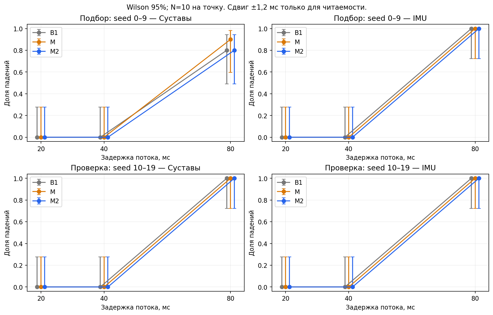

# Отчёт: H1 на CPU, асинхронные сенсорные пакеты и компенсация

Состояние на 9 октября 2026 года. Автор исследовательской работы — Захар
Островский. Документ объединяет завершённые этапы и предложения продолжения.
Предложения ниже не являются выполненными экспериментами или доказанной новизной.

Этот документ сохраняет результаты baseline, M и M2 до разработки M3.
Последующее исследование, включая зафиксированный профиль и закрытую серию,
описано в [отчёте M3](../results/m3_h1/REPORT.md).
Утверждения ниже о неоткрытых seed относятся к историческому этапу M2.

**Последующий результат M3:** выполнены 1400 закрытых эпизодов после
фиксации модели. В исходных шести E2 на seed 100–139 B1/M/M2/M3 дали
80/79/79/40 падений из 240 на метод. Основной критерий выполнен:
снижение M3 относительно B1 на 16,67 п.п. M3 устраняет проверенные
падения I80, но при J80 все эпизоды падают, в среднем раньше B1;
скорость при J20/J40 отслеживается хуже. Полные таблицы, интервалы,
диагностика, новые графики и ограничения — в отдельном отчёте M3.

## 1. Полученный результат

Готовая рекуррентная политика H1 запущена в MuJoCo на CPU. Реализованы
независимые очереди IMU и суставных пакетов, задержки, потери, удержание
показаний, исходный кинематический M и составной M2. Есть интерактивная
симуляция с переключением алгоритма, командой движения и блокировкой пакетов.

**Основная гипотеза о снижении числа падений пока не подтверждена.**
На дополнительной проверке seed 10–19 у B1, M и M2 по 20 падений из 60
эпизодов. M2 улучшает RMSE скорости при J20/J40; при J80 его среднее
время до падения меньше, чем у M. Улучшение отдельной метрики не заменяет
улучшение устойчивости.

[Все графики и таблицы](REPORT.md#readme). [Установка и запуск](../README.md).

## 2. Что было выполнено

| Этап | Работа | Первичные материалы |
|---|---|---|
| Теория | Анализ источников, постановка вопроса, протокол и границы выводов | [research](../docs/README.md#research), [protocol](../docs/README.md#experiment_protocol) |
| CPU baseline | Минимальный inference без Isaac Gym, штатные соглашения H1, проверка памяти LSTM | [Отчёт baseline](../results/baseline_h1/REPORT.md) |
| Пакеты и M | Причинные очереди, отдельный возраст потоков, кинематическое предсказание | [Описание](../docs/README.md#sensor_age_implementation) |
| Пилот | 548 численных эпизодов seed 0–9, подбор горизонтов и дополнительные режимы | [Отчёт пилота](../results/pilot_h1/REPORT.md) |
| Демонстрации | 20 секунд и свободный режим, клавиши I/J/W/C/R/Esc, камера, запись логов | [Инструкция](../docs/README.md#interactive_demo) |
| Разработка M2 | 13 вариантов, включая составной; 1066 основных численных запусков | [Отчёт M2](../results/m2_validation_h1/REPORT.md) |
| Дополнительная проверка | 180 парных E2-эпизодов на seed 10–19, фиксированный профиль | [Метрики](../results/m2_validation_h1/validation_summary.json) |
| Регрессии M2 | 100 clean/E3/jitter эпизодов, 3 технических повтора frontend | [Отчёт M2](../results/m2_validation_h1/REPORT.md) |
| Оформление | Общий отчёт, установка, навигация, 6 рисунков, 5 таблиц, очистка кэшей | [Журнал](../results/repository_maintenance/REPORT.md) |

1066 запусков M2 включают 780 эпизодов подбора/составной проверки,
180 дополнительной проверки, 100 регрессий и 6 начальных технических
эпизодов. Число запусков не равно числу независимых наблюдений: варианты
параметров и визуальные повторы используют те же seed. Закрытая серия
seed 100–139 не выполнена. При оформлении новые исследовательские серии
не запускались; выполнены только технические проверки установки и повторения.

## 3. Условия и воспроизводимость

- Linux x86_64, Intel Core i9-12900H; Python 3.10.12, Torch 2.5.1+cpu,
  MuJoCo 3.2.7, NumPy 1.26.4. NVIDIA GPU не использовался.
- Проектная `.venv`; один поток Torch intra-op/inter-op и OMP/OpenBLAS/MKL.
- Unitree RL Gym commit `276801e46c5d433564f24658bac64f254b7d2d4b`.
- Checkpoint SHA-256: `44a0fbceb81f3877833ae9a398d039bea1759cb0d3c8188181013885f70589eb`.
- Scene SHA-256: `88ffcccad2c5df71a7472b4b30ec7e4ea06e045efc6b4e11ccd8bebc2848f0b3`.
- Физика/PD: шаг 2 мс; политика: 20 мс, 50 Гц. Вход 41, выход 10.
  Готовая политика содержит LSTM, её память не должна меняться при shape probe.
- Команда основных испытаний `[0.5, 0, 0]`; эпизод 20 секунд,
  разгон 2 секунды; возмущения начальных суставных углов ±0,003 рад.
- Критерий падения пилота: pelvis ниже 0,6197924543 м либо |roll/pitch|
  более 60° непрерывно 0,2 секунды. Численный эпизод заканчивается при падении.
- Команды, нормализация, PD, веса и порядок признаков между методами одинаковы.

Фактические версии, CPU, потоки, конфигурации и хеши хранятся в
`summary.json` каждого эпизода. Исторические команды установки и запусков:
[baseline](../results/baseline_h1/REPORT.md),
[пилот](../results/pilot_h1/REPORT.md#commands),
[M2](../results/m2_h1_setup/commands.md).
Новое [requirements.txt](../requirements.txt) фиксирует версии рабочего
окружения, [setup.sh](../scripts/setup.sh) готовит CPU-запуск.

## 4. Какие данные задерживаются и пропадают

**Суставной пакет:** положения и скорости десяти приводимых суставов ног.
**IMU-пакет:** угловая скорость корпуса и направление гравитации в системе
корпуса. В этой модели направление гравитации вычисляется из ориентации
MuJoCo; сырые показания акселерометра не моделируются отдельно.

У пакета есть время измерения и доставки. Политике доступен только уже
доставленный пакет с наиболее новым временем измерения. Старый приход
не заменяет более новый. При потере новых пакетов последнее показание
удерживается, его возраст растёт; значения не заменяются нулями.

Не пропадают команды, фаза шага и предыдущее действие. Локальный PD
использует свежие суставные показания. Поэтому эксперимент не моделирует
разрыв обратной связи непосредственно на приводах.

Адаптер видит только доставленные данные, их метки и известные постоянные.
Текущее истинное состояние и будущие пакеты доступны физике/метрикам,
но не компенсатору. Компенсация выполняется до штатной нормализации.

## 5. Сравниваемые алгоритмы

| Метод | Принцип | Роль |
|---|---|---|
| B0 | Свежие наблюдения | Контроль исправности |
| B1 | Последний доставленный пакет каждого потока | Основной baseline |
| M | q + dq·min(age,H); вращение гравитации с −omega, ограниченный горизонт | Исходная компенсация, выбранные H=20/20 мс |
| M2 | Периодическая история суставов + прежний M20 для IMU | Выбранный новый профиль |
| B2/AJ/AI | Общий максимальный возраст / только суставы / только IMU | Диагностики пилота, N=1 на точку |

M2 использует до 60 доставленных измерений, период 0,8 с, три Fourier-гармоники,
ridge 0,001, половину модельной поправки и горизонт суставов 120 мс.
Предсказание начинается после накопления полного периода. Поправки ограничены;
при нулевом возрасте сохраняется точная identity. q и dq корректируются
отдельными якорными поправками, а не точным интегрированием единой скорости.

13 кандидатов включают ускорительные, периодические, перенос изменения
прошлого цикла, затухающие и составной варианты.
[Полная таблица](tables/README.md#candidates), [график](figures/candidates.png),
[формулы и порядок выбора](../docs/README.md#m2_development).
Сохранены все отрицательные результаты. Выбор сделан на seed 0–9;
профиль зафиксирован до seed 10–19 и не подстраивался по ним.

## 6. Измеренные результаты

### Штатная ходьба

За 20 секунд робот прошёл по x 8,344 м, боковое смещение 0,148 м,
без падения. После разгона средняя продольная скорость 0,431 м/с
при команде 0,5 м/с; RMSE горизонтальной скорости 0,147 м/с.
Это конкретный baseline, а не статистика устойчивости всех возможных условий.

### Основные асинхронные условия E2

J20/J40/J80 — задержка только суставов, I20/I40/I80 — только IMU.
Другой поток свежий. По 10 seed на условие и метод.

| Выборка | Метод | Падения / эпизоды | Среднее T_alive, с | Среднее RMSE, м/с |
|---|---|---:|---:|---:|
| Подбор, seed 0–9 | B1 | 18/60 | 16,151 | 0,338 |
| Подбор, seed 0–9 | M | 19/60 | 16,257 | 0,328 |
| Подбор, seed 0–9 | M2 | 18/60 | 16,476 | 0,308 |
| Проверка, seed 10–19 | B1 | 20/60 | 15,754 | 0,332 |
| Проверка, seed 10–19 | M | 20/60 | 16,041 | 0,339 |
| Проверка, seed 10–19 | M2 | 20/60 | 15,924 | 0,321 |

На seed 10–19 при J40 RMSE B1/M/M2: 0,152/0,182/0,137 м/с.
M2 уменьшил ошибку примерно на 25% относительно M; все эти эпизоды без падений.
При J80 все методы упали в 10/10 случаев; T_alive M/M2: 10,056/9,355 с.
При I80 все методы также упали в 10/10 случаев.



[Полная таблица с Wilson-интервалами](tables/README.md#comparison),
[ошибка скорости](figures/velocity_rmse.png),
[время до падения](figures/mean_alive_s.png).

`ALL` агрегирует шесть условий на каждый seed, поэтому 60 эпизодов —
это 10 кластеров seed. RMSE рассчитан после разгона и до падения,
а затем усреднён по эпизодам. Разная длина аварийных траекторий создаёт
смещение; меньший RMSE при более раннем падении не доказывает улучшение.

При 0/10 падений верхняя граница Wilson 95% около 27,75%.
Парный bootstrap по seed на дополнительной проверке дал разность падений
B1−M2 и M−M2 0 с вырожденным интервалом [0;0]: исходы всех пар совпали.
Это свойство наблюдаемой выборки, не доказательство эквивалентности.
Дополнительная проверка на 10 seed не заменяет исходную закрытую серию.

### Другие режимы сбоев

- Равные постоянные задержки: на пилоте B1/M при 20/40 мс без падений,
  при 80/120 мс падения в 10/10. **M2 здесь не проверен.**
- Одна серия 1/2/4/6 потерянных пакетов одного потока: B1/M/M2 без падений
  во всех проверенных точках. Шесть пропусков дают максимальный возраст 120 мс.
- Независимый jitter 0/20/40 мс: B1/M/M2 без падений на seed 0–9.
  Перестановка доставки реально наблюдалась и корректно отвергалась.
- Clean: у выбранного M2 точное совпадение входов, действий и физических
  измерений с сохранённым B1 на всех 10 seed.

[Режимы сбоев](figures/fault_modes.png), [таблица](tables/README.md#extensions).
Одна короткая потеря и постоянно устаревший поток — разные воздействия.
Эти результаты не означают устойчивости к произвольному удержанию I/J.

### Вычислительная стоимость

| Метод | Адаптер median / p95, мс | Полный цикл median / p95, мс |
|---|---:|---:|
| B1 | 0,0039 / 0,0045 | 1,3153 / 1,4820 |
| M | 0,0113 / 0,0536 | 1,3397 / 1,5148 |
| M2 | 0,2644 / 0,3769 | 1,6330 / 1,8417 |

Реальные такты 60 проверочных E2-эпизодов на метод, один поток CPU.
Адаптер M2 включает обновление истории и fit. Цикл исключает загрузку
и финальную запись; рендеринг не входит в эти измерения.
[Таблица компонентов](tables/README.md#cpu_timing), [график](figures/cpu_timing.png).
Все p95 ниже периода 20 мс на этом компьютере; гарантия real-time
при любой нагрузке не установлена.

## 7. Интерактивная демонстрация

Свободный режим запускается `./scripts/launch_h1_sandbox.sh` и работает
до Esc. W переключает команду 0/0,5 м/с, C — B1/M2, R поднимает робота
и включает команду стоять; I/J блокируют новые пакеты при удержании.
Камера закреплена на роботе и допускает вращение на фиксированном расстоянии.

R сбрасывает динамическое состояние, действия, LSTM и историю компенсатора.
C сохраняет историю доставленных пакетов. Стояние — нулевая команда готовой
политики, не фиксация координат: в длительном чистом испытании был дрейф.
Неудачные варианты статического PD сохранены и не представлены как решение.

Проверены управление и совпадение frontend: 16 с симуляции в окне за
16,300 с реального времени, без падения. Входы, действия, qpos/qvel и возраст
на этом участке побитово совпали с headless-повтором. Это техническая
проверка, не доказательство устойчивости всех ручных сценариев.

## 8. Проверки реализации и текущего оформления

Исторически прошли 30 математических/пакетных unit-проверок, 4 проверки
ограниченной демонстрации, 3 свободного режима, аудит причинности
280 дополнительных эпизодов и парности E2 по хешам, проверки frontend.
Проверялся нулевой возраст, постоянная скорость, знак вращения гравитации,
горизонт, причинность, старые приходы и рост возраста при потерях.

В текущем оформлении заново проверены установка `--offline`, точные
зависимости и 26 хешей ассетов; выполнен 5-секундный smoke-run без падения.
Дополнительные проверки и реальные команды записаны в
[журнале оформления](../results/repository_maintenance/REPORT.md).
Полная загрузка и установка в совершенно пустое окружение отдельно
не проверена; установленный и проверенный набор версий зафиксирован.

## 9. Перспективы развития

Все направления ниже — предложения. Их эффективность и научная новизна
ещё не установлены. Для новых вариантов нужны отдельные данные разработки
и последующая проверка зафиксированного метода. Seed 100–139 оставлены закрытыми.

| Направление | Проверяемая гипотеза и эксперимент | Приоритет |
|---|---|---|
| Карта задержек и фазы | Задержки 40–80 мс с меньшим шагом, совместные задержки; одинаковую потерю запускать в разных фазах шага | Высокий |
| Чувствительность политики | Какие ошибки q/dq/omega/g сильнее меняют действие; оценить на одной записанной траектории с сохранением памяти LSTM | Высокий |
| Доверие к прогнозу | Менять вес поправки по ошибкам прошлых прогнозов при приходе пакета, а не только по возрасту | Высокий |
| Адаптивный период | Оценивать период/фазу из доставленной истории вместо фиксированных 0,8 с; проверить переходы идти/стоять | Средний |
| Последействие памяти LSTM | Измерить восстановление после окончания сбоя; проверить, сохраняется ли эффект старых входов | Высокий |
| Малый обучаемый адаптер | Линейная авторегрессия или небольшая сеть на CPU; восстановление входа при неизменной политике | Средний |
| Согласование времени | Привести оба физических блока к общему доступному прошлому времени и сравнить с предсказанием вперёд | Средний |
| Модель с историей действий | Оценивание/фильтрация с известными ранее выданными действиями; отдельно расширить ограничения протокола | Далее |
| Приоритет доставки | При одинаковом бюджете связи выбирать поток по возрасту и ожидаемой важности для управления | Далее |
| Обобщение | Другие скорости, повороты, коррелированные потери, шум и ошибка часов; затем другая готовая политика | Далее |
| Измерительная демонстрация | Графики возраста, наклона и доверия, повтор одинакового расписания для разных методов | Практический |

### С чего продолжать

Сначала построить карту сбоев и измерить чувствительность политики.
При диагностике можно временно подставлять истинный блок состояния как
oracle-контроль, но он должен быть явно отделён от допустимого адаптера.
Это покажет, какой канал ограничивает результат и помогает ли идеальное
восстановление выбранного блока в проверенном сценарии.

Затем выбрать один подход: прогноз с оценкой доверия либо маленький
обучаемый адаптер. У последнего истинное состояние допустимо как цель
обучения, но не как вход во время испытания. Разделять наборы по эпизодам;
случайное деление соседних строк даёт утечку. Кроме ошибки состояния
можно исследовать близость действий фиксированной политики, затем
обязательно оценивать реальные замкнутые эпизоды и падения.

Важный отдельный вопрос — память LSTM. Любые диагностические вызовы
политики должны сохранять/восстанавливать её состояние. Возможная коррекция
памяти через повторный проход истории должна оставаться причинной,
не использовать истинную скрытую историю или будущие пакеты и учитывать
пиковое CPU-время. Гарантия полезности такого изменения пока отсутствует.

Модель с ранее выданными действиями расширяет нынешний интерфейс адаптера:
это изменение протокола нужно объявить до сравнения. Свежие реальные
PD-торки, зависящие от истинных q/dq, нельзя незаметно использовать как
дополнительные доступные сенсоры. Аналогично отдельный балансирующий
контроллер меняет постановку фиксированной политики; простая команда
«стоять» в наших проверках не обеспечивает фиксацию позиции.

### Связь с литературой

Компенсация задержанных наблюдений и использование временной информации
уже изучались, например в [Blind Decision Making](https://arxiv.org/abs/2011.07715).
Близкий препринт [Decoupled Delay Compensation](https://arxiv.org/abs/2605.26286)
предлагает модуль оценки состояния перед готовыми MARL-политиками,
объединяющий обучаемую модель перехода и Kalman-фильтрацию.
Это литературные факты по доступным аннотациям; полный разбор этой новой
работы в текущем проекте не выполнен. Их результаты не устанавливают
эффективность на H1. Нельзя объявлять внешний адаптер или память впервые
предложенными только на основании нашей реализации.

Потенциальный вклад проекта — воспроизводимая оценка границ компенсации
для фиксированной H1-политики, раздельных возрастов потоков и измеренных
отрицательных результатов. Вариант дальнейшей темы:
**«Компенсация асинхронных сенсорных задержек с учётом чувствительности
готовой рекуррентной политики ходьбы»**.

## 10. Что осталось нерешённым

Нет подтверждённого снижения числа падений. Постоянные I80/J80 остаются
неустойчивыми; длинные ручные отключения и переходы не покрыты основной
серией. Стояние в точке не обеспечено. M2 при совместных постоянных
задержках ещё не измерен. Закрытая серия и перенос на реального робота
не выполнены. Все выводы ограничены готовой политикой H1, симуляцией,
текущими начальными состояниями и задержками только на входе политики.

Данные, отрицательные результаты и снимки исходников сохранены.
Исследовательский этап оформления не превращает неподтверждённую гипотезу
в подтверждённую; публикация и отправка материалов не выполнялись.


---

<a id="readme"></a>

# Отчёт, графики и таблицы

Основной документ — [REPORT.md](REPORT.md). Все изображения построены
из сохранённых измерений, без новых исследовательских запусков.

| График: PNG / PDF | Что показывает |
|---|---|
| [Падения](figures/fall_rate.png) / [PDF](figures/fall_rate.pdf) | Задержки 20/40/80 мс, B1/M/M2, потоки отдельно, Wilson 95% |
| [Скорость](figures/velocity_rmse.png) / [PDF](figures/velocity_rmse.pdf) | RMSE скорости при тех же условиях |
| [Время движения](figures/mean_alive_s.png) / [PDF](figures/mean_alive_s.pdf) | Среднее время до падения, ограниченное 20 с |
| [Режимы сбоев](figures/fault_modes.png) / [PDF](figures/fault_modes.pdf) | Одна серия потерь, равные задержки, fresh и jitter |
| [Кандидаты](figures/candidates.png) / [PDF](figures/candidates.pdf) | Все 13 вариантов подбора, включая неудачные |
| [CPU](figures/cpu_timing.png) / [PDF](figures/cpu_timing.pdf) | Медиана/p95 адаптера, политики и цикла |

| Таблица: Markdown / CSV | Содержание |
|---|---|
| [Сравнение](tables/README.md#comparison) / [CSV](tables/comparison.csv) | Все E2-условия, две раздельные выборки |
| [Расширения](tables/README.md#extensions) / [CSV](tables/extensions.csv) | Clean, jitter, равные задержки, серии потерь |
| [Кандидаты](tables/README.md#candidates) / [CSV](tables/candidates.csv) | Итоги подбора |
| [CPU](tables/README.md#cpu_timing) / [CSV](tables/cpu_timing.csv) | Время компонентов |
| [Режимы запуска](tables/README.md#run_modes) / [CSV](tables/run_modes.csv) | Возможности, длительность и управление |

`ALL` — шесть условий на каждый из 10 seed, не 60 независимых seed.
RMSE аварийных эпизодов усечён до падения. У M2 нет измерений равных
постоянных задержек двух потоков; соответствующие точки отсутствуют.
Нулевые падения при одной короткой серии потерь не означают устойчивости
к длительной постоянной задержке или ручному отключению.

Перестроить из корня:

```bash
.venv/bin/python -I scripts/build_report_assets.py
```

Происхождение и SHA-256 исходных таблиц — [assets_manifest.json](assets_manifest.json).
